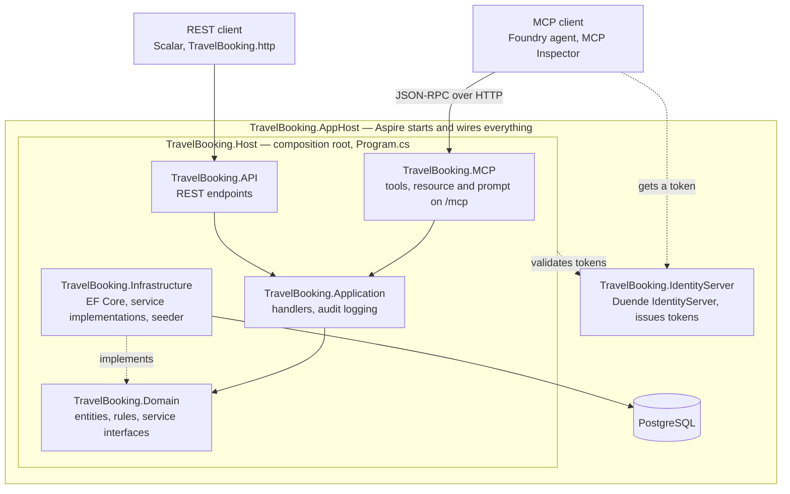
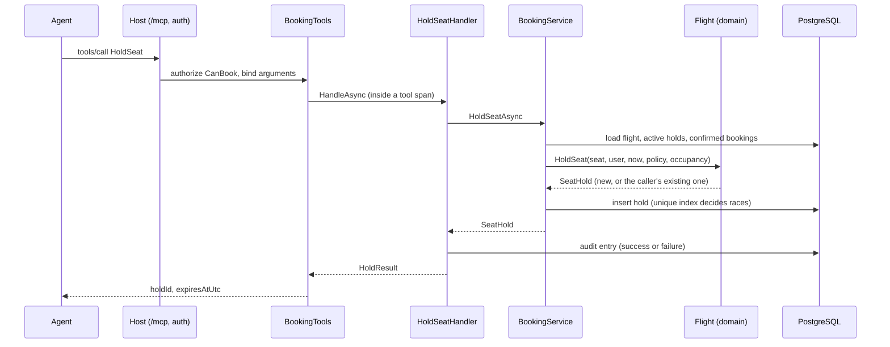
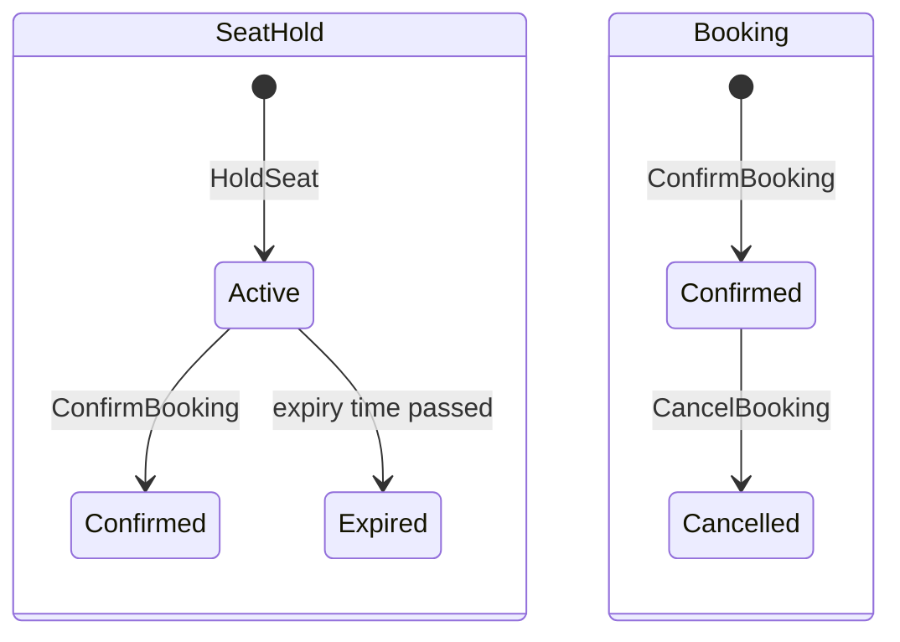

# Architecture

A short tour of the Travel Booking MCP server. Decisions are kept short here;
each row links to the ADR that explains the *why*.

## The shape

A Clean Architecture .NET 11 solution. Domain at the centre, Infrastructure (EF Core + Postgres) plugged in via interfaces, and two equal entry points on top — a REST API for testing and an MCP server for agents. Both share the same Application handlers. The whole thing is orchestrated locally by .NET Aspire, which also starts the identity provider (Duende IdentityServer) that issues the tokens the server validates from Lab 5 onward; the same code deploys to Azure Container Apps.



Solid arrows are calls; dotted arrows are the relationships that are easy to miss. Besides
the two entry points, the Host migrates and seeds the database on startup, pulls in
`TravelBooking.ServiceDefaults` (OpenTelemetry, health checks, resilience defaults) and
serves `/health`, `/alive`, and in Development `/openapi` and `/admin/reset-data`.

## One tool call, end to end

What happens when an agent calls `HoldSeat`. Every tool follows the same path; only the
domain rule in the middle differs.



| Step | Where | What it adds |
|------|-------|--------------|
| Pipeline | [`Program.cs`](./src/TravelBooking.Host/Program.cs) | Authentication, the `CanBook` policy, wire logging of `/mcp` requests |
| Tool | [`BookingTools.cs`](./src/TravelBooking.MCP/Tools/BookingTools.cs) | The description the model reads, the caller's identity, a span, a counter, and domain errors turned into `McpException` |
| Handler | [`HoldSeatHandler.cs`](./src/TravelBooking.Application/Handlers/HoldSeatHandler.cs) | Audit logging and the mapping to a DTO; the REST endpoint calls the same handler |
| Service | [`BookingService.cs`](./src/TravelBooking.Infrastructure/Services/BookingService.cs) | Loading state, saving, and turning a unique-index violation into a domain error |
| Domain | [`Flight.cs`](./src/TravelBooking.Domain/Models/Flight.cs) | The rules: seat exists, flight not departed, seat free, hold limit per caller |

## Folder layout

```
src/
├── TravelBooking.Domain/          ← entities, interfaces, no deps           (ADR 0001)
├── TravelBooking.Application/     ← handlers, depends on Domain only        (ADR 0004)
├── TravelBooking.Infrastructure/  ← EF Core, services impl, seeder          (ADR 0002)
├── TravelBooking.API/             ← REST endpoints + exception handlers
├── TravelBooking.MCP/             ← MCP tools (Lab 1 fills this in), one resource, one prompt (ADR 0006)
├── TravelBooking.Host/            ← composition root, Program.cs
├── TravelBooking.IdentityServer/  ← workshop identity provider (Duende IdentityServer, Lab 5)
├── aspire/
│   ├── TravelBooking.AppHost/         ← Aspire orchestrator                  (ADR 0003)
│   └── TravelBooking.ServiceDefaults/ ← shared OTEL / health / resilience
└── tests/
    └── TravelBooking.Tests/       ← unit and integration tests mirroring src/ layout
```

## Key decisions (each links to a full ADR in [`/docs/adr`](./docs/adr/README.md))

| Decision | Why it matters | ADR |
|----------|---------------|-----|
| Clean Architecture, six layer projects | Each gate touches a specific layer; API and MCP are peers, both call Application. | [0001](./docs/adr/0001-clean-architecture.md) |
| PostgreSQL + EF Core (no in-memory) | Attendees can query state; resilience lab gets real transient errors. | [0002](./docs/adr/0002-postgresql-and-ef-core.md) |
| .NET Aspire for local orchestration | One command, networked services, OTEL dashboard for free. | [0003](./docs/adr/0003-aspire-for-local-orchestration.md) |
| Plain services (no MediatR) | OSS constraint; explicit dispatch, simpler stack traces. | [0004](./docs/adr/0004-plain-services-over-mediatr.md) |
| Records for DTOs, classes for entities | Intent on the type signature; tests get value equality for free. | [0005](./docs/adr/0005-records-for-dtos.md) |
| MCP over HTTP streamable (not stdio) | Same transport locally, over the public Codespaces port, and in Azure. | [0006](./docs/adr/0006-http-streamable-mcp-transport.md) |
| Hold expiration computed on read | No background sweeper; tests fast-forward via `TimeProvider`. | [0007](./docs/adr/0007-computed-hold-expiration.md) |
| Audit logging from handlers | Explicit, captures business intent on both success and failure paths. | [0008](./docs/adr/0008-audit-logging-from-handlers.md) |
| OSS-only NuGet packages | Attendees adopt patterns without procurement friction. | [0009](./docs/adr/0009-oss-only-nuget-packages.md) |
| Centralized Package Management | One file for versions; cuts transitive warnings. | [0010](./docs/adr/0010-centralized-package-management.md) |

## The domain in one diagram

A `Flight` has many `SeatHold`s; confirming a hold creates a `Booking`. Each has its own
small lifecycle:



A seat on a flight is `Available` ⇔ no active hold AND no confirmed booking
for `(FlightId, SeatNumber)`. Four rules the diagram cannot show:

- **Expiry is computed, not swept.** A hold past its `ExpiresAtUtc` counts as expired even
  while its status still says `Active`; the status is only updated when someone next asks
  for that seat.
- **Retries are safe.** The owner holding the same seat again gets the same hold back, and
  the owner confirming an already confirmed hold gets the same booking back.
- **Only the owner** may confirm a hold or cancel a booking.
- **The database has the last word.** Unique indexes on `(FlightId, SeatNumber)` — one for
  active holds, one for confirmed bookings — let exactly one of two concurrent requests win.

The full rule set lives in [`docs/storyline/`](./docs/storyline/).

## Running locally

```bash
# Start everything (Postgres + pgAdmin + IdentityServer + the Host)
aspire run
```

Without the Aspire CLI, `dotnet run --project src/aspire/TravelBooking.AppHost` does the same.
The dashboard URL is printed on stdout (`http://localhost:15095` by default). Open it to
see every resource, its endpoints, logs and traces; the Host itself listens on
`http://localhost:5197`, with the MCP endpoint at `/mcp`.

## See also

- [README.md](./README.md) — workshop summary
- [src/README.md](./src/README.md) — the demo app: tools, resource, prompt, project layout
- [labs/README.md](./labs/README.md) — the hands-on labs, one per gate
- [docs/storyline/](./docs/storyline/) — the narrative (chapters 00–08)
- [docs/adr/](./docs/adr/) — the full ADR set
