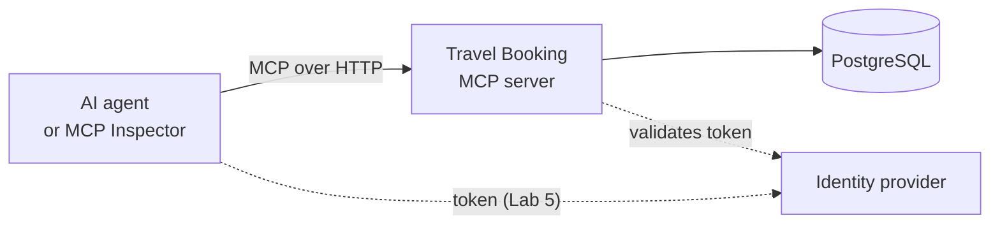

# End-to-End MCP Server Development in .NET — From Local Debugging to Azure

A hands-on workshop for **VS Live**, November 20, 2026 (8 hours, intermediate–advanced).
By **Loek Duys** (Microsoft MVP, LoekD Consultancy) and **Alex Thissen**.

You will build a single **MCP server in ASP.NET Core** and walk it across the chasm
between "works on my laptop" and "survives production" — closing one engineering **gate**
at a time: make it work, debuggable, observable, resilient, secure, and deployable to Azure.

Everything runs in **GitHub Codespaces** — bring only a laptop with a modern browser.

## Repository layout

| Path | Contents |
|------|----------|
| [`docs/storyline/`](./docs/storyline/) | The workshop narrative — overview + one file per chapter |
| [`src/`](./src/) | The Travel Booking MCP server (ASP.NET Core, .NET 11) — the finished solution |
| [`labs/`](./labs/) | Step-by-step hands-on labs, one per gate, plus the scripts that reset the code to the start of each lab |
| [`infra/attendee/`](./infra/attendee/) | Scripts that provision each attendee's Azure AI Foundry agent |
| [`.devcontainer/`](./.devcontainer/) | The Codespaces dev container |
| [`ARCHITECTURE.md`](./ARCHITECTURE.md) | How the code works: component diagram, one tool call end to end, decisions |

## What you build

A **Travel Booking MCP server**: six tools an AI agent calls to search flights, hold a
seat, and confirm or cancel a booking, backed by PostgreSQL. Seat holds expire after a short
time, which is what makes the tracing, resilience and idempotency lessons real.

`src/` holds the finished server. Each lab starts from an earlier state of that code and
adds one gate's worth of it back; [`src/README.md`](./src/README.md) describes the app and
[`ARCHITECTURE.md`](./ARCHITECTURE.md) explains how a request moves through it.

## The storyline at a glance

> **"Crossing the Chasm: From Demo to Production."**

Start here: **[docs/storyline/00-overview.md](./docs/storyline/00-overview.md)**.

| # | Chapter | Gate | Lab |
|---|---------|------|-----|
| 00 | Welcome & Setup | — | [Lab 0](./labs/lab-00-setup.md) |
| 01 | Foundations: Agentic AI, LLMs/SLMs & MCP | — | — |
| 02 | Make It Work | Gate 1 | [Lab 1](./labs/lab-01-make-it-work.md) |
| 03 | Make It Debuggable | Gate 2 | [Lab 2](./labs/lab-02-make-it-debuggable.md) |
| 04 | Make It Observable | Gate 3 | [Lab 3](./labs/lab-03-make-it-observable.md) |
| 05 | Make It Resilient | Gate 4 | [Lab 4](./labs/lab-04-make-it-resilient.md) |
| 06 | Make It Secure | Gate 5 | [Lab 5](./labs/lab-05-make-it-secure.md) |
| 07 | Make It Deployable (Azure) | Gate 6 | [Lab 6](./labs/lab-06-make-it-deployable.md) |
| 08 | Wrap-Up & Production Checklist | — | — |

## Key learnings

Agentic AI and the Model Context Protocol; modern tooling for distributed apps
(Dev Tunnels, Dev Proxy); the Microsoft MCP libraries for .NET and ASP.NET Core;
testing MCP servers locally and from the cloud; authentication and authorization;
hosting and deployment to Microsoft Azure; and OpenTelemetry instrumentation for
tracing agentic AI solutions.

## Status

The storyline, the demo app and the labs are in place and are being refined through lab
dry runs; the slide deck is still to come.

## License

[MIT](./LICENSE).
