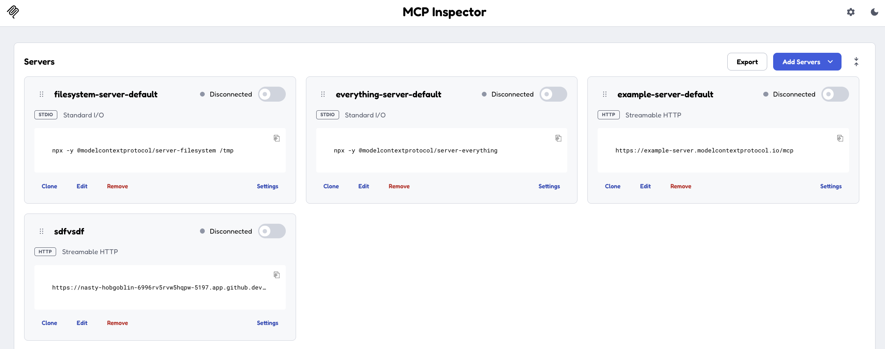
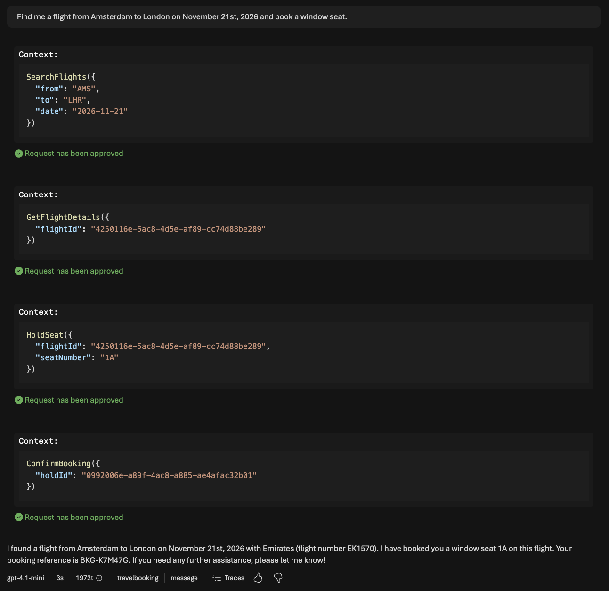

# Lab 1 — Make It Work (Gate 1)

In this lab you will turn the Travel Booking application into an MCP server. You will write
all six tools, test them with MCP Inspector, and then hand them to the **AI agent** you
provisioned in Lab 0 — discovering why "works in the Inspector" is not the same as "works".

> ⏱ Expected time: ~45 minutes.
> Prerequisite: [Lab 0](lab-00-setup.md) completed — Aspire running, REST API healthy,
> port 5197 public, agent provisioned.
> Catching up? `./labs/prepare-lab.sh 1` puts the code exactly where this lab starts.
> Done? `./labs/prepare-lab.sh check 1` diffs your tree against the finished state of this lab.

## The plan

The application logic already exists: the Application layer has a handler per use case
(`SearchFlightsHandler`, `HoldSeatHandler`, ...). MCP tools are a thin layer on top —
exactly like the REST endpoints, but speaking MCP instead of HTTP+JSON conventions. You
will:

1. Write two tool classes in `src/TravelBooking.MCP/Tools/`
2. Register the MCP server in the Host (the ready-made resource and prompt in
   `Resources/` and `Prompts/` ride along; they are the other two MCP primitives)
3. Test with MCP Inspector — protocol level, no AI involved
4. Hand the tools to your Foundry agent and make it book a flight

Two clients, two jobs. **MCP Inspector** is a protocol test harness: deterministic, you
choose the arguments, and it shows you the raw JSON-RPC. **The Foundry agent** is a real
LLM client: non-deterministic, *it* chooses the arguments, and it will surprise you. You
need both, and the difference between them is most of this lab.

## Create the flight tools

Create a new file `src/TravelBooking.MCP/Tools/FlightTools.cs` with this content:

```csharp
using System.ComponentModel;
using ModelContextProtocol.Server;
using TravelBooking.Application.Handlers;

namespace TravelBooking.MCP.Tools;

[McpServerToolType]
public class FlightTools(
    SearchFlightsHandler searchFlights,
    GetFlightDetailsHandler getFlightDetails)
{
    [McpServerTool(Name = "SearchFlights")]
    [Description("Searches for direct flights between two airports on a specific date. " +
        "Returns a list of flights with id, flight code, airline, departure/arrival times (UTC), " +
        "price in USD, and the number of available seats. " +
        "Use the returned flight id with GetFlightDetails or HoldSeat.")]
    public async Task<IReadOnlyList<FlightSummary>> SearchFlightsAsync(
        [Description("IATA code of the departure airport, e.g. 'AMS'.")] string from,
        [Description("IATA code of the arrival airport, e.g. 'LHR'.")] string to,
        [Description("Travel date in YYYY-MM-DD format.")] DateOnly date,
        CancellationToken cancellationToken)
    {
        return await searchFlights.HandleAsync(from, to, date, cancellationToken);
    }

    [McpServerTool(Name = "GetFlightDetails")]
    [Description("Gets full details for a single flight by its id, including the list of " +
        "available seat numbers. Use this to pick a seat before calling HoldSeat.")]
    public async Task<FlightDetails?> GetFlightDetailsAsync(
        [Description("The flight id returned by SearchFlights.")] Guid flightId,
        CancellationToken cancellationToken)
    {
        return await getFlightDetails.HandleAsync(flightId, cancellationToken);
    }
}
```

Two things to notice before you move on:

- `[McpServerToolType]` marks the class as a container of tools; every method with
  `[McpServerTool]` becomes a callable tool. The handler dependencies are resolved from DI
  per invocation — the same scoped handlers the REST API uses.
- The `[Description]` attributes are **not documentation — they are an API for the model**.
  The LLM decides whether and how to call your tool based on these strings. We will prove
  this the hard way at the end of this lab. Budget them: Azure AI Foundry caps a tool
  description at **1,024 characters**, so they have to earn their space.

## Create the booking tools

Create `src/TravelBooking.MCP/Tools/BookingTools.cs`:

```csharp
using System.ComponentModel;
using ModelContextProtocol.Server;
using TravelBooking.Application.Handlers;

namespace TravelBooking.MCP.Tools;

[McpServerToolType]
public class BookingTools(
    HoldSeatHandler holdSeat,
    ConfirmBookingHandler confirmBooking,
    GetBookingHandler getBooking,
    CancelBookingHandler cancelBooking)
{
    [McpServerTool(Name = "HoldSeat")]
    [Description("Places a temporary hold on a specific seat of a flight. The hold expires " +
        "after a few minutes; confirm it with ConfirmBooking before it expires. " +
        "Returns the hold id and the exact UTC expiration time.")]
    public async Task<HoldResult> HoldSeatAsync(
        [Description("The flight id returned by SearchFlights.")] Guid flightId,
        [Description("The seat number to hold, e.g. '12A'. Must be one of the available " +
            "seats returned by GetFlightDetails.")] string seatNumber,
        CancellationToken cancellationToken)
    {
        return await holdSeat.HandleAsync(flightId, seatNumber, userId: null, cancellationToken);
    }

    [McpServerTool(Name = "ConfirmBooking")]
    [Description("Confirms a seat hold and turns it into a booking. Fails if the hold has " +
        "already expired. Returns the booking with its booking reference.")]
    public async Task<BookingResult> ConfirmBookingAsync(
        [Description("The hold id returned by HoldSeat.")] Guid holdId,
        CancellationToken cancellationToken)
    {
        return await confirmBooking.HandleAsync(holdId, userId: null, cancellationToken);
    }

    [McpServerTool(Name = "GetBooking")]
    [Description("Gets a booking by its id, including its status (Confirmed or Cancelled), " +
        "seat number and booking reference.")]
    public async Task<BookingResult?> GetBookingAsync(
        [Description("The booking id returned by ConfirmBooking.")] Guid bookingId,
        CancellationToken cancellationToken)
    {
        return await getBooking.HandleAsync(bookingId, cancellationToken);
    }

    [McpServerTool(Name = "CancelBooking")]
    [Description("Cancels an existing booking, freeing up its seat. Returns the cancelled " +
        "booking. Fails if the booking is already cancelled.")]
    public async Task<BookingResult> CancelBookingAsync(
        [Description("The booking id returned by ConfirmBooking.")] Guid bookingId,
        CancellationToken cancellationToken)
    {
        return await cancelBooking.HandleAsync(bookingId, userId: null, cancellationToken);
    }
}
```

## Register the MCP server in the Host

The Host project already references `TravelBooking.MCP` — it just doesn't use it yet. Open
`src/TravelBooking.Host/Program.cs` and make three changes.

**1.** Add two using directives at the top of the file, keeping the list alphabetical
(`ModelContextProtocol` sorts before `TravelBooking`):

```csharp
using ModelContextProtocol.AspNetCore;
using TravelBooking.MCP.Tools;
```

**2.** Register CORS and the MCP server. Add this *below* the line
`builder.Services.AddOpenApi();`:

```csharp
builder.Services.AddCors(options =>
{
    options.AddDefaultPolicy(policy =>
    {
        policy.AllowAnyOrigin()
              .AllowAnyHeader()
              .AllowAnyMethod();
    });
});

builder.Services.AddMcpServer()
    .WithHttpTransport(options =>
        options.SessionMode = HttpServerSessionMode.StatefulForInitializeClients)
    .WithToolsFromAssembly(typeof(FlightTools).Assembly)
    .WithResourcesFromAssembly(typeof(FlightTools).Assembly)
    .WithPromptsFromAssembly(typeof(FlightTools).Assembly);
```

> The last two lines register the other two MCP primitives. `Resources/` and `Prompts/` in
> the MCP project already hold one of each — a static baggage-policy document and a
> reusable booking workflow — so the server can show tools, resources *and* prompts side by
> side. They are not part of this lab's exercise; `src/README.md` explains what each is for.

> `SessionMode`: the SDK's default is *stateless* HTTP, in which the server never issues an
> `Mcp-Session-Id`. This hybrid mode keeps a session for clients that still start with the
> `initialize` handshake and serves newer clients — your Foundry agent among them —
> statelessly. Lab 2 shows you both kinds of request on the wire.

> Note the assembly argument: without it, `WithToolsFromAssembly()` scans the *calling*
> assembly — the Host — and finds zero tools. The server would start fine and report an
> empty tool list. This is one of the classic "why doesn't my client see any tools?"
> mistakes, and now you can never make it.

Why CORS? **Browser-based** MCP clients — MCP Inspector, which you are about to use, and
IDE clients running in VS Code for the Web — make cross-origin calls to your endpoint.
Without a CORS policy those calls fail, often *silently*. Your Foundry agent calls
server-to-server from Azure and is unaffected by CORS, which is worth noticing: the same
server has to satisfy two very different kinds of caller, and only one of them is a
browser.

**3.** Map the endpoint. Add this *below* `app.UseExceptionHandler();`:

```csharp
app.UseCors();
app.MapMcp("/mcp");
```

That's it. The MCP server and the REST API are peers in the same ASP.NET Core pipeline:
same DI container, same handlers, same database — and, later today, the same middleware for
auth and telemetry.

## Run it

Stop Aspire if it is still running (`Ctrl+C` in its terminal) and start it again:

```bash
aspire run
```

Verify the server is up:

```bash
curl -s http://localhost:5197/health
```

> Why a separate `/health` endpoint? Because `/mcp` speaks JSON-RPC — its responses are not
> valid health probes. Azure Container Apps will need this distinction in Lab 6.

## Test with MCP Inspector

MCP Inspector is the protocol-level test tool for MCP servers. Start it in a new terminal:

```bash
npx @modelcontextprotocol/inspector
```

A browser tab opens with the Inspector UI (Codespaces forwards the port automatically — if
no tab opens, `Ctrl+Click` the URL in the terminal output).

> **Every Connect answers "Forbidden"?** Inspector only accepts browser requests whose
> `Origin` it was told about, and by default that is `http://localhost:6274`. In a Codespace
> the page lives on `https://<codespace>-6274.app.github.dev`, and the forwarding proxy
> rewrites the browser's `Origin` on the way in (to `https://localhost:6274`, typically), so
> neither form is on the default list. The Codespace pre-sets `ALLOWED_ORIGINS` with all of
> them for you (see `.devcontainer/codespaces/devcontainer.json`). If you started the
> Inspector some other way, set it yourself before launching:
>
> ```bash
> export ALLOWED_ORIGINS="https://${CODESPACE_NAME}-6274.app.github.dev,https://localhost:6274,http://localhost:6274"
> npx @modelcontextprotocol/inspector
> ```
>
> `GET` calls still succeed because browsers omit `Origin` on same-origin `GET`; only the
> `POST` that saves the server entry is refused, which is why the UI loads but Connect fails.

1. Set **Transport Type** to `Streamable HTTP`.
2. Set the **URL** to `http://localhost:5197/mcp`.
3. Click **Connect**.
4. Open the **Tools** tab and click **List Tools**.

You should see all six tools: `SearchFlights`, `GetFlightDetails`, `HoldSeat`,
`ConfirmBooking`, `GetBooking`, `CancelBooking` — each with the description you wrote.

While you are here, peek at the other two primitives: the **Resources** tab → **List
Resources** shows `baggage-policy`, and clicking it reads the Markdown; the **Prompts** tab
→ `book-flight` → **Get Prompt** with a `from`, `to` and `date` returns the workflow
messages — and nothing gets booked, a prompt only returns text.

Now call one. Select `SearchFlights`, fill in the same `from`/`to`/`date` values you used in
Lab 0, and click **Run Tool**. You should get back the same flights as JSON.



Walk the full flow in the Inspector: `SearchFlights` → `GetFlightDetails` (pick a seat) →
`HoldSeat` → `ConfirmBooking`. Your MCP server works!

## Pin it down with a test

The Inspector showed six tools because you looked. Make the build look for you. The test
project has an in-process MCP harness (`InProcessMcp` in
`src/tests/TravelBooking.Tests/TestHelpers`) that runs the same three assembly scans as the
Host and talks to them the way a client does — no HTTP, no Aspire. The resource and prompt
tests in `src/tests/TravelBooking.Tests/Mcp/McpServerPrimitivesTests.cs` already use it.
Add one for the tools at the end of that class:

```csharp
    [Fact]
    public async Task ListTools_still_advertises_the_six_booking_tools()
    {
        await using var mcp = await InProcessMcp.StartAsync();
        var tools = await mcp.Client.ListToolsAsync(cancellationToken: TestContext.Current.CancellationToken);

        tools.Select(t => t.Name).Should().BeEquivalentTo(
            "SearchFlights", "GetFlightDetails", "HoldSeat", "ConfirmBooking", "GetBooking", "CancelBooking");
    }
```

Run it:

```bash
dotnet test TravelBooking.slnx --filter-method "*ListTools_still_advertises_the_six_booking_tools"
```

Green. From now on a refactor that renames a tool, drops one, or loses the assembly scan
fails `dotnet test` instead of the demo.

So far the server has only faced a protocol inspector and a unit test, where *you* chose
every argument. Now let's hand it to something that chooses its own.

## Hand the tools to your agent

Your agent has been pointed at `https://$CODESPACE_NAME-5197.app.github.dev/mcp` since
Lab 0 — it just had nothing to call. Now it does, and **no reconfiguration is needed**.

Make sure port 5197 is still public (the Codespace publishes it on every start, but
running this again never hurts):

```bash
gh codespace ports visibility 5197:public -c "$CODESPACE_NAME"
```

Open your playground link from Lab 0. Lost it? Re-run the script — it is idempotent, and
it reprints the link:

```bash
./infra/attendee/deploy.sh --mcp-url "https://${CODESPACE_NAME}-5197.app.github.dev/mcp"
```

Now ask a travel question, using your own route and date from Lab 0, **year included**:

```
Find me a flight from Amsterdam to London on November 21st, 2026 and
book a window seat. Confirm the booking right away.
```

> Why the year? The model has no clock. Given "November 21st" alone it picks a year from
> its training data, searches a date with no flights, and answers "there are no direct
> flights" for a route that exists. The agent's instructions now carry today's date, but
> an explicit year in the prompt removes the guess entirely. If the agent ever reports
> no flights for a route Lab 0 found, open the approval prompt and read the `date` it sent.

The agent will ask you to **approve each tool call** before it runs. Approve them one at
a time and watch the chain build: `SearchFlights` → `GetFlightDetails` → `HoldSeat` →
`ConfirmBooking`, ending in a booking reference.

Take a moment on that approval prompt. It shows you the **exact arguments the model
invented** for each call — the flight id it chose, the seat it picked. You did not supply
any of them. That prompt is the last point at which a human sees what the model is about
to do, and it is the reason the agent you deploy in Lab 6 should not simply be trusted.

Your chat session should look similar to this:


We keep approvals on for this lab because watching the chain is the point. From Lab 2 you
will switch them off, because approving four calls per question all day gets old fast.

**An AI agent, running in Azure, just used the server you built in your Codespace.**

> **The agent answered from general knowledge and called no tools?** Three things to
> check, in order: is port 5197 still **Public**; does
> `curl -s "https://${CODESPACE_NAME}-5197.app.github.dev/health"` return `Healthy` from a
> terminal; and does the Inspector still list six tools. The failure is almost always the
> port, and almost never the model.

## Break it on purpose

The number-one first experience in the wild: a server that passes the Inspector but fails
with a real client. Let's manufacture the classic cause so you recognize it forever.
**Undo the change after you've seen the failure.**

### The endpoint mismatch

In the Inspector, disconnect and reconnect with the URL `http://localhost:5197/api/mcp` —
a path that doesn't exist. The connection fails and no tools appear. Your server logs
nothing useful: the request 404s in the ASP.NET Core pipeline before MCP ever sees it.

*Lesson: when a client sees no tools, check the URL and transport before you suspect your
code.* Reconnect to `/mcp` and confirm the tools come back.

The same mistake with your agent is harder to spot and slower to fix, because the wrong
URL lives in Azure rather than in a text box:

```bash
# don't actually run this unless you want to wait twice
./infra/attendee/deploy.sh --mcp-url "https://${CODESPACE_NAME}-5197.app.github.dev/api/mcp"
```

The agent would report that it cannot reach its tools, and nothing in your Codespace would
look wrong at all. Diagnosing from the client side is a skill you will need again today.

> **Foundry remembers your tool list.** The agent service fetches `tools/list` from your
> server once and keeps the result with the agent; a new chat, or a reload of the playground,
> does not ask again (your server sees no `tools/list`, yet the run still reports an
> `mcp_list_tools` item). A renamed tool, a changed description or a new parameter therefore
> stays invisible to the agent until the agent gets a **new version**, which `deploy.sh`
> cuts whenever the definition changes — Lab 2 does that with `--approval never`. The
> Inspector always shows the live list, so when the two disagree, that is why.

> Two more classics you'll hear about in the recap, which our setup already avoids:
> **stdout pollution** (anything printed to stdout corrupts the protocol on stdio
> transport — we use HTTP, where logs and protocol never share a stream) and **SDK version
> mismatch** (we pin `ModelContextProtocol.AspNetCore` centrally in
> `Directory.Packages.props`).

## If things go wrong

- Database in a weird state from repeated booking attempts:
  `curl -s -X POST http://localhost:5197/admin/reset-data`
- Tools not appearing in the Inspector at all: confirm the `WithToolsFromAssembly(...)`
  argument (and its two `WithResources…`/`WithPrompts…` siblings) and that
  `app.MapMcp("/mcp")` is present, then rebuild.
- `HoldSeat` (or another tool) fails for the agent with a server log saying
  **`The JSON value could not be converted to System.Guid`** — read the `flightId` the
  agent sent, which the approval prompt shows you. Count the characters: a GUID's last
  group has twelve, and a small model copying a 36-character id from a tool result drops
  one or two now and then. Nothing is wrong with your server; the model mangled an opaque
  identifier. **Start a new chat** before you retry: the broken id lives in the
  conversation, and the model will keep reusing it as long as that conversation is in
  front of it, failing the same call every time. This failure mode is exactly why
  Lab 2 makes errors loud — today the model only hears "an error occurred" — and why ids
  a model has to carry around should be as short and as human-shaped as you can make them.
- The agent reports **"Authentication failed … 401 (Unauthorized)"** — you have not
  written any auth code yet, so this is not what it sounds like. Two different things
  produce it, and one command tells them apart:

  ```bash
  curl -s -i "https://${CODESPACE_NAME}-5197.app.github.dev/mcp" \
    -H "Content-Type: application/json" -H "Accept: application/json, text/event-stream" \
    -d '{"jsonrpc":"2.0","id":1,"method":"tools/list"}' | head -3
  ```

  A **`302`** to `github.dev/pf-signin` means port 5197 reverted to private and GitHub is
  intercepting — re-run the `ports visibility` command above. A **`401`** carrying a
  `WWW-Authenticate: Bearer` header means your own server is demanding a token, which at
  this point in the day means `UseIdentityServer` is `true` in
  `src/aspire/TravelBooking.AppHost/appsettings.json` (that is Lab 5's switch). Set it
  back to `false` and restart Aspire.
- Ask a proctor — diagnosing this gap *is the skill this lab teaches*, you don't have to
  suffer alone.

## Gate closed ✅

> ☑ **Work** ☐ Debuggable ☐ Observable ☐ Resilient ☐ Secure ☐ Deployable

Your MCP server works — with a real client, not just the inspector. That is a higher bar
than most first servers clear. Next question: when it breaks, can you *see* why?

---

*Next up: [Lab 2 — Make It Debuggable](lab-02-make-it-debuggable.md).*
