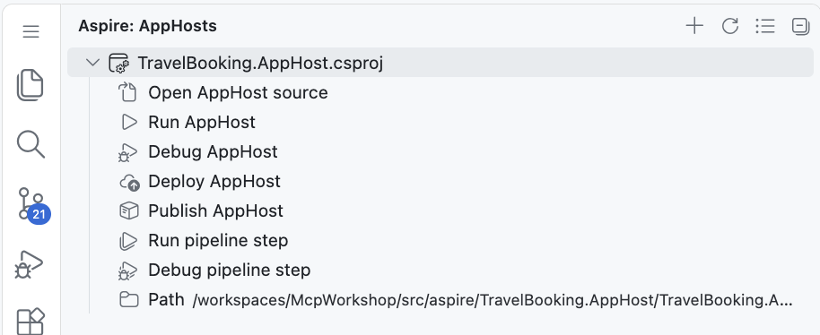

# Lab 2 — Make It Debuggable (Gate 2)

In this lab you will get any MCP request to a breakpoint, turn a silent failure into a
loud well-logged one, and see the raw traffic your agent is actually sending — including
two headers that will matter for the rest of the day.

> ⏱ Expected time: ~45 minutes.
> Prerequisite: [Lab 1](lab-01-make-it-work.md) completed — all six tools working.
> Catching up? `./labs/prepare-lab.sh 2` puts the code exactly where this lab starts.
> Done? `./labs/prepare-lab.sh check 2` diffs your tree against the finished state of this lab.

## Why this gate exists

The server works — until it doesn't, and then the failure happens *between* a cloud client
and code on your machine. The agent says "something went wrong", the user sees an apology,
and you see… nothing. Most MCP debugging pain is a **visibility** problem, not a logic
problem. This lab is about getting the visibility back.

## Attach the debugger

The Host runs as a child process of the orchestrator, and the Aspire extension for VS Code
starts the whole AppHost with the debugger already attached to every project in it:

1. Stop Aspire if it is still running from Lab 1 (`Ctrl+C` in its terminal).
2. Set a breakpoint in `src/TravelBooking.Application/Handlers/HoldSeatHandler.cs`, on the
   first line of `HandleAsync` (click in the gutter left of the line number).
3. Open the **Aspire** view in the activity bar, expand `TravelBooking.AppHost.csproj` and
   click **Debug AppHost**.



Wait for the dashboard to show every resource **Running**, as in Lab 0. Now drive a tool
call: in MCP Inspector (still connected from Lab 1, reconnect if needed), call `HoldSeat`
with a flight id and a seat number such as `12A`.

The flight id has to be a GUID. Anything else is rejected as a bad request before your code
runs, and the breakpoint never hits. Either works:

- **Any GUID**, if you only want to see the breakpoint hit. Copy this one:

  ```text
  3f2b8c1e-9a47-4d6b-b5e0-7c1d2a9f4e63
  ```

  No flight has that id, so the hold fails once you continue, but the handler is reached.
- **A real flight id**, if you want the hold to succeed. Run `SearchFlights` first with
  `from` = `AMS`, `to` = `MCO` and `date` = `2026-11-21`, and copy the `id` of a flight
  from the result.

The breakpoint hits. Look around:

- **Variables** shows the exact arguments the tool received. Today you typed them into the
  Inspector; in production, *a language model* makes them up. You don't control these
  inputs — treat every argument as untrusted. This idea returns with force in Lab 5.
- The **Call Stack** shows the whole path: ASP.NET Core pipeline → MCP server → your tool →
  the handler. Same stack the REST API would produce below the entry point — one codebase,
  two front doors.

Press `F5` to continue. Leave the debug session running: stopping it (`Shift+F5`) stops
Aspire with it, and the rest of this lab needs the server up.

Notice which client we used: the **Inspector**, not the agent. That was deliberate, and
the next section shows why.

### Why not debug through the agent?

Try it. The debugger is still attached and the breakpoint still set, so this time ask the
agent in the playground to book a seat. Sit on the breakpoint — make a coffee, take your time.

After **100 seconds**, the agent's tool call fails, even though your server is alive,
correct, and about to return a perfectly good answer. Azure AI Foundry gives a
non-streaming MCP call 100 seconds and then gives up.

That is not a bug to work around; it is the shape of the problem this whole gate exists
for. **A client with a timeout turns "slow" into "broken".** You cannot step through code
while a real client is waiting on it, which is why breakpoints do not scale past your own
laptop — and why the rest of today is about traces and logs rather than debuggers.

For the remainder of the workshop: **debug with the Inspector** (deterministic, patient,
no model in the loop) and **verify with the agent**. Remove your breakpoints before you go
back to the playground. Stopping the debug session (`Shift+F5`) also stops Aspire; start it
again with **Run AppHost** in the Aspire view, or `aspire run` in a terminal.

> Hold this thought for Lab 4, where we make latency the main character. Latency is a
> reliability problem, and you have now felt it.

## Make failures loud

Time to see what a *silent* failure looks like. With no breakpoints left behind, use the
Inspector to call `ConfirmBooking` with a random made-up GUID:

```
holdId: 00000000-0000-0000-0000-000000000001
```

The tool call fails — but look closely at the result in the Inspector. The error is marked
as an error, yet the message is generic. The actual reason (`Hold ... not found.`) is
buried in a server-side exception the client never sees. An agent receiving this can only
tell the user "something went wrong" — it has no information to *recover* with, even
though "that hold doesn't exist, search again" is perfectly actionable.

The fix has two halves: **tell the client what happened**, and **log it on the server**.

Open `src/TravelBooking.MCP/Tools/BookingTools.cs` and replace the class declaration and
the `ConfirmBookingAsync` method so the class gets a logger and the tool reports domain
failures properly:

```csharp
using System.ComponentModel;
using Microsoft.Extensions.Logging;
using ModelContextProtocol;
using ModelContextProtocol.Server;
using TravelBooking.Application.Handlers;
using TravelBooking.Domain;

namespace TravelBooking.MCP.Tools;

[McpServerToolType]
public class BookingTools(
    HoldSeatHandler holdSeat,
    ConfirmBookingHandler confirmBooking,
    GetBookingHandler getBooking,
    CancelBookingHandler cancelBooking,
    ILogger<BookingTools> logger)
{
```

…and the method:

```csharp
    [McpServerTool(Name = "ConfirmBooking")]
    [Description("Confirms a seat hold and turns it into a booking. Fails if the hold has " +
        "already expired. Returns the booking with its booking reference.")]
    public async Task<BookingResult> ConfirmBookingAsync(
        [Description("The hold id returned by HoldSeat.")] Guid holdId,
        CancellationToken cancellationToken)
    {
        try
        {
            var booking = await confirmBooking.HandleAsync(holdId, userId: null, cancellationToken);
            logger.LogInformation("Booking {BookingReference} confirmed for hold {HoldId}",
                booking.BookingReference, holdId);
            return booking;
        }
        catch (BookingDomainException ex)
        {
            logger.LogWarning(ex, "ConfirmBooking failed for hold {HoldId}: {Reason}",
                holdId, ex.Message);
            throw new McpException(ex.Message);
        }
    }
```

Two deliberate choices here:

- `McpException` is the SDK's "this message is safe to send to the client" exception. Its
  message travels to the agent as the tool error; any *other* exception type stays generic
  on purpose, so internals (connection strings, stack traces) never leak into a prompt.
- The log line uses **structured logging** — named placeholders, not string interpolation —
  so `HoldId` and `Reason` become queryable fields, not just text.

Now give `HoldSeatAsync` and `CancelBookingAsync` the same treatment. They throw
`BookingDomainException` for expired holds, taken seats and double cancellations — all
actionable for an agent. Each method body is currently a single `return await …` line;
replace that line with the `try/catch` below (the signatures stay as they are).

`GetBookingAsync` stays as it is: it is a read, and its handler answers an unknown id with
`null` rather than an exception, so there is nothing to catch — the agent gets an empty
result it can reason about. Only the three tools that *change* state can fail a domain rule.

`HoldSeatAsync`:

```csharp
        try
        {
            return await holdSeat.HandleAsync(flightId, seatNumber, userId: null, cancellationToken);
        }
        catch (BookingDomainException ex)
        {
            logger.LogWarning(ex, "HoldSeat failed for flight {FlightId}, seat {SeatNumber}: {Reason}",
                flightId, seatNumber, ex.Message);
            throw new McpException(ex.Message);
        }
```

`CancelBookingAsync`:

```csharp
        try
        {
            return await cancelBooking.HandleAsync(bookingId, userId: null, cancellationToken);
        }
        catch (BookingDomainException ex)
        {
            logger.LogWarning(ex, "CancelBooking failed for booking {BookingId}: {Reason}",
                bookingId, ex.Message);
            throw new McpException(ex.Message);
        }
```

Restart Aspire and repeat the bogus `ConfirmBooking` call:

- The Inspector now shows the real reason:
  `An error occurred invoking 'ConfirmBooking': Hold 00000000-... not found.`
- In the Aspire dashboard, open **Structured logs**, filter on `travelbooking-host` —
  there's your warning, with `HoldId` as a structured field. Right next to it sits an
  **Error** from the MCP SDK (`"ConfirmBooking" threw an unhandled exception.`, stack
  trace and all): the SDK logs every `McpException` it turns into a tool error. That is
  expected, not a sign that your fix missed.

That's the difference between a failure that vanishes and a failure you can find at 2am.

## Watch the raw traffic

Your server has been reachable from the public internet since Lab 0, and an agent in Azure
has been calling it. But you have never actually *seen* what it sends — and the question
Lab 1 left open is exactly that: when something fails, is it the **client sending the
wrong thing** or **your tool doing the wrong thing**?

Stop guessing. Log it.

Create `src/TravelBooking.MCP/McpRequestLogging.cs`:

```csharp
using System.Text;
using Microsoft.AspNetCore.Builder;
using Microsoft.AspNetCore.Http;
using Microsoft.Extensions.DependencyInjection;
using Microsoft.Extensions.Logging;

namespace TravelBooking.MCP;

public static class McpRequestLogging
{
    /// <summary>
    /// Logs the headers and JSON-RPC body of every request to the MCP endpoint.
    /// Workshop aid: it logs request bodies verbatim, which in a real system
    /// would mean customer data in your logs. Never ship this as-is.
    /// </summary>
    public static IApplicationBuilder UseMcpRequestLogging(this IApplicationBuilder app, string path)
    {
        return app.Use(async (context, next) =>
        {
            if (!context.Request.Path.StartsWithSegments(path))
            {
                await next();
                return;
            }

            var logger = context.RequestServices
                .GetRequiredService<ILoggerFactory>()
                .CreateLogger("TravelBooking.Mcp.Wire");

            var headers = new StringBuilder();
            foreach (var (key, value) in context.Request.Headers)
            {
                // Never log credentials - Lab 5 puts a bearer token on these calls.
                var shown = key.Equals("Authorization", StringComparison.OrdinalIgnoreCase)
                    ? "<redacted>"
                    : value.ToString();
                headers.Append($"\n    {key}: {shown}");
            }

            context.Request.EnableBuffering();
            var body = await new StreamReader(context.Request.Body, leaveOpen: true).ReadToEndAsync();
            context.Request.Body.Position = 0;

            logger.LogInformation("MCP {Method} {Path}{Headers}\n  body: {Body}",
                context.Request.Method, context.Request.Path, headers.ToString(), body);

            await next();
        });
    }
}
```

Wire it up in `src/TravelBooking.Host/Program.cs`, immediately **above** `app.MapMcp("/mcp")`:

```csharp
using TravelBooking.MCP;
```

```csharp
app.UseMcpRequestLogging("/mcp");
```

Restart Aspire, ask the agent to book a flight, then open the Aspire dashboard →
**Structured logs** and filter on `TravelBooking.Mcp.Wire`.

There it is: for every tool the agent uses, a `server/discover` — the agent asking your
server which protocol versions and capabilities it supports — followed by a `tools/call`
carrying the tool name and the arguments **the model invented**. The same view you would
have paid an APM vendor for, in fifteen lines.

### Headers worth knowing by name

Scroll to the headers on any request. Among them:

```txt
User-Agent: AzureAIFoundryAgentRuntime/244898599
Mcp-Method: tools/call
Mcp-Name: ConfirmBooking
```

**`User-Agent`** tells you which of your two clients is talking: `AzureAIFoundryAgentRuntime`
is the Foundry agent, `node` is the Inspector. When a log line looks wrong, check this
first — a surprising number of "the agent did X" puzzles turn out to be Inspector requests.

**`Mcp-Method`** and **`Mcp-Name`** repeat what the body says — the JSON-RPC method and,
for a tool call, the tool — so a proxy or a log filter can tell requests apart without
parsing JSON.

> You may have read about a header called `Mcp-Session-Id`. Do not expect it on the agent's
> requests. It belongs to the older, stateful way of talking MCP: the client opens with
> `initialize`, the server hands out a session id, and the client repeats it on every
> request. The Foundry agent now talks to your server statelessly — no `initialize`, no
> session — and each request carries what the server needs to know in the body's `_meta`
> instead. A client that still starts with `initialize` gets a session id from your server
> and sends it back; if you see the header, that is the client you are looking at.

> The agent sends one more header worth a glance, `x-ms-foundry-baggage`: it names the
> Foundry project, the agent and its **version**. When you wonder whether the playground is
> talking to the agent version you just deployed, this is the answer.

Lab 3 comes back to these headers for a third one, `traceparent` (W3C Trace Context).
Whether your agent sends it decides what you see on the traces page, so that is where it
gets its moment.

## Turn off the approval prompts

You have seen what the approval prompt is for. From here on it is friction — four extra
clicks for every question, all afternoon. Switch it off:

```bash
./infra/attendee/deploy.sh \
  --mcp-url "https://${CODESPACE_NAME}-5197.app.github.dev/mcp" \
  --approval never
```

Only the agent's approval policy changes; everything else is left exactly as it was.

> ⚠️ **Use the playground link this run prints, and bookmark that one instead.**
> The approval policy is part of the agent's *definition*, and agent versions are
> immutable — so changing it publishes a new version. The link from Lab 0 ends in
> `?version=1` and will keep opening the old version, where the prompts are still on.
>
> From here on, re-running `deploy.sh` without `--approval` **keeps** whatever policy
> the agent already has, so you only have to say this once.

> Worth being honest about what you just did: you removed the human from the loop so the
> demo would flow better. That is the same trade every team makes when they move an agent
> from pilot to production, usually with less thought than you just gave it. Labs 4 and 5
> are about what has to be true of your *server* once nobody is checking each call.

## Gate closed ✅

> ☑ Work ☑ **Debuggable** ☐ Observable ☐ Resilient ☐ Secure ☐ Deployable

You can now get any request to a breakpoint, read every payload on the wire, and your
failures announce themselves with actionable messages and structured logs. But breakpoints
don't scale to production — and they definitely don't scale to a non-deterministic agent
making three tool calls per question. For that, we need traces.

---

*Next up: [Lab 3 — Make It Observable](lab-03-make-it-observable.md).*
