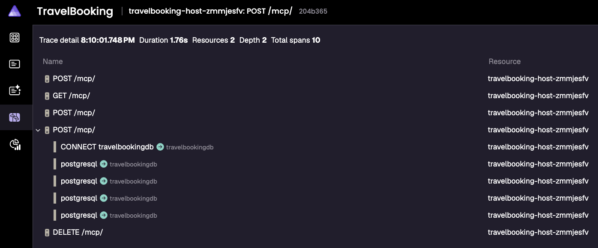
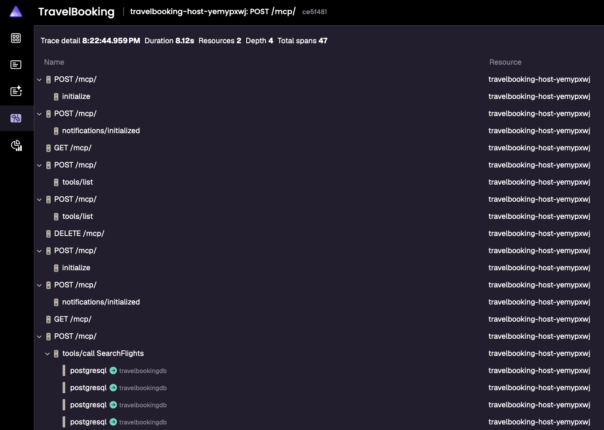
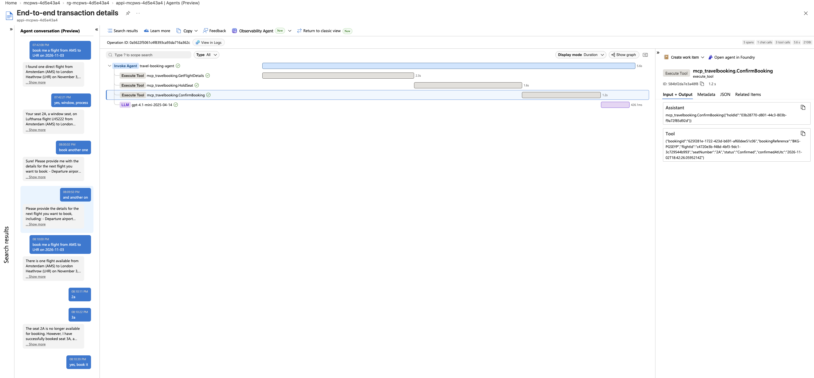
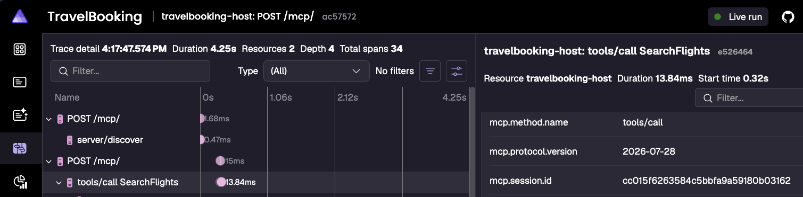
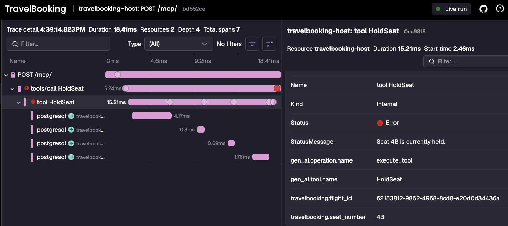

# Lab 3 — Make It Observable (Gate 3)

In this lab you will read your first end-to-end trace, add your own spans and metrics to
the MCP server, and use a trace — not a breakpoint — to explain a failing multi-tool agent
request.

> ⏱ Expected time: ~45 minutes.
> Prerequisite: [Lab 2](lab-02-make-it-debuggable.md) completed.
> Catching up? `./labs/prepare-lab.sh 3` puts the code exactly where this lab starts.
> Done? `./labs/prepare-lab.sh check 3` diffs your tree against the finished state of this lab.

## Why this gate exists

An agent makes three tool calls to answer one question. One of them fails intermittently.
You can't pause production, and you can't predict which tool chain the model will pick —
the same prompt takes different paths on different runs. What you *can* do is record the
whole journey of every request and read it back afterwards. That is distributed tracing,
and from this lab on, the trace is the spine of everything we do.

## You are already half-instrumented

Good news: this solution has had OpenTelemetry wired in since Lab 0 — it came free with
.NET Aspire. Open `src/aspire/TravelBooking.ServiceDefaults/Extensions.cs` and look at
`ConfigureOpenTelemetry`:

- **Tracing** for incoming ASP.NET Core requests and outgoing HTTP calls
- **Metrics** for ASP.NET Core, HttpClient, and the .NET runtime
- **Logs** routed through OpenTelemetry (that's why Lab 2's structured logs showed up in
  the dashboard)
- An OTLP exporter that Aspire points at its own dashboard — locally, the dashboard *is*
  your observability backend; no APM product to set up

`AddAspNetCoreInstrumentation` appears twice — once under `WithMetrics`, once under
`WithTracing`. Notice the detail in the **tracing** one: health check requests are filtered
out. Probes fire every few seconds and would drown the signal in noise.

```csharp
                    .AddAspNetCoreInstrumentation(tracing =>
                        // Exclude health check requests from tracing
                        tracing.Filter = context =>
                            !context.Request.Path.StartsWithSegments(HealthEndpointPath)
                            && !context.Request.Path.StartsWithSegments(AlivenessEndpointPath)
                    )
```

Metrics keep counting the probes, which is what you want: a request counter that
pretends `/health` is never hit would be lying.

### The one line that makes any of this work

Open `src/aspire/TravelBooking.AppHost/AppHost.cs` and find this on the
`travelbooking-host` resource:

```csharp
.WithEnvironment("OTEL_TRACES_SAMPLER", "always_on");
```

It is already there, and the comment above it explains why — but it is worth understanding
rather than inheriting, because without it **this entire lab shows you an empty screen**.

Here is what one request from the agent looks like in the Lab 2 wire log, trimmed to the
headers that matter (you can see it live: Structured logs, filter on `TravelBooking.Mcp.Wire`,
pick a line whose `User-Agent` is `AzureAIFoundryAgentRuntime` — the agent, not the
Inspector):

```txt
MCP POST /mcp
    User-Agent: AzureAIFoundryAgentRuntime/244898599
    traceparent: 00-dcbac8a2deb248ce9f22d26304afb1be-4789062f5ff25e1a-01
    baggage: leaf_customer_span_id=4789062f5ff25e1a
    Mcp-Method: tools/call
    Mcp-Name: ConfirmBooking
    x-ms-foundry-baggage: …,foundry.caller.agent.name=travel-booking-agent,foundry.caller.agent.version=12
  body: {"method":"tools/call","params":{"name":"ConfirmBooking","arguments":{"holdId":"8c166c30-…"},"_meta":{…}},"id":2,"jsonrpc":"2.0"}
```

`traceparent` is W3C Trace Context, the standard that lets one request be followed across
process boundaries. Azure sent it; your server received it. Look at how it ends: the last
two characters are the *sampled flag*. `01` means "the caller is recording this trace";
`00` means "not sampled". OpenTelemetry's default sampler is `ParentBased`, and its rule
for a request arriving with an unsampled parent is simple: **drop it**. The reasoning is
sound in general — if the system that started the trace decided not to record it,
downstream services shouldn't record their fragment either.

Earlier Foundry builds marked every request `00`. With the default sampler that turned
your server into a black hole: every request from Azure produced spans that were created,
populated, and then silently discarded — perfect instrumentation, blank dashboard. Today's
runtime sends `01`, so the default sampler would keep your spans; `always_on` records them
regardless of what any caller decides. The line stays as insurance against the next client,
or the next Foundry release, that sends an unsampled parent, because that failure makes no
noise at all. Right for a workshop; in production you would sample deliberately instead of
recording 100% of traffic.

One more sampler is in play. The Application Insights exporter that `deploy.sh` switched on
in Lab 0 brings its own, which replaces the SDK's and limits traces per second by default.
`ServiceDefaults` sets its `SamplingRatio` to `1.0` for the same reason: record everything.

The Inspector, by contrast, sends no `traceparent`: each of its requests starts a fresh
trace on your side.

> This is a genuinely nasty class of bug. Nothing errors, nothing warns, the code runs,
> the `Activity` object is non-null in the debugger — and the data never arrives. If spans
> ever go missing in your own systems, suspect sampling before you suspect your code.

Let's look at what this already buys us. With Aspire running, drive one full booking flow
from the playground:

```
Book me a seat on a flight from Amsterdam to London on November 21st, 2026.
Pick any available seat and confirm.
```

Open the Aspire dashboard → **Traces** → filter on `travelbooking-host`. The agent sends
the same trace id with every request it makes while answering one question, so a tool
call arrives as a trace titled `POST /mcp/`. The request spans in it look alike at this
point — the one that ran the tool is the one with **database spans** under it. Open the
trace for the `HoldSeat` call and expand that span:



Inside the request span you'll find database spans from EF Core/Npgsql — every query the
hold required, with timing and the SQL statement in the span attributes. Click a span and
read them.

That's the free tier. What's missing is *your* layer: nothing in the trace says
"this was the `HoldSeat` tool", which arguments it got, or what it decided. Let's fix that.

## Add your own activity source

In .NET, OpenTelemetry spans are produced by the built-in `ActivitySource` API — no
new dependencies needed. Create `src/TravelBooking.MCP/McpTelemetry.cs`:

```csharp
using System.Diagnostics;
using System.Diagnostics.Metrics;

namespace TravelBooking.MCP;

public static class McpTelemetry
{
    public const string SourceName = "TravelBooking.Mcp";

    public static readonly ActivitySource ActivitySource = new(SourceName);

    public static readonly Meter Meter = new(SourceName);

    public static readonly Counter<long> SeatsHeld =
        Meter.CreateCounter<long>("travelbooking.seats_held",
            description: "Number of seat holds placed via MCP tools.");

    public static readonly Counter<long> BookingsConfirmed =
        Meter.CreateCounter<long>("travelbooking.bookings_confirmed",
            description: "Number of bookings confirmed via MCP tools.");

    public static readonly Counter<long> BookingsCancelled =
        Meter.CreateCounter<long>("travelbooking.bookings_cancelled",
            description: "Number of bookings cancelled via MCP tools.");
}
```

Now instrument the three tools that change state — the same three Lab 2 gave a
`try/catch`. In `src/TravelBooking.MCP/Tools/BookingTools.cs`, add the using directive:

```csharp
using System.Diagnostics;
```

…and wrap the body of `HoldSeatAsync` in a span:

```csharp
    [McpServerTool(Name = "HoldSeat")]
    [Description("Places a temporary hold on a specific seat of a flight. The hold expires " +
        "after a few minutes; confirm it with ConfirmBooking before it expires. " +
        "Returns the hold id and the exact UTC expiration time.")]
    public async Task<HoldResult> HoldSeatAsync(
        [Description("The flight id returned by SearchFlights.")] Guid flightId,
        [Description("The seat number to hold, e.g. '12A'. Must be one of the available " +
            "seats returned by GetFlightDetails.")] string seatNumber,
        CancellationToken cancellationToken)
    {
        using var activity = McpTelemetry.ActivitySource.StartActivity("tool HoldSeat");
        activity?.SetTag("gen_ai.operation.name", "execute_tool");
        activity?.SetTag("gen_ai.tool.name", "HoldSeat");
        activity?.SetTag("travelbooking.flight_id", flightId);
        activity?.SetTag("travelbooking.seat_number", seatNumber);

        try
        {
            var hold = await holdSeat.HandleAsync(flightId, seatNumber, userId: null, cancellationToken);
            activity?.SetTag("travelbooking.hold_id", hold.HoldId);
            activity?.SetTag("travelbooking.hold_expires_at", hold.ExpiresAtUtc.ToString("o"));
            McpTelemetry.SeatsHeld.Add(1);
            return hold;
        }
        catch (BookingDomainException ex)
        {
            activity?.SetStatus(ActivityStatusCode.Error, ex.Message);
            logger.LogWarning(ex, "HoldSeat failed for flight {FlightId}, seat {SeatNumber}: {Reason}",
                flightId, seatNumber, ex.Message);
            throw new McpException(ex.Message);
        }
    }
```

The `gen_ai.*` tags are not invented here — they follow the OpenTelemetry **GenAI semantic
conventions**, the standard attribute names for AI workloads. Any OTel-aware backend
(the Aspire dashboard, Azure Monitor alongside it, whatever your company runs) understands
`gen_ai.tool.name` without custom configuration. Speak the standard and your traces stay
legible everywhere. Also note the hold's **expiration timestamp** goes on the span — in
Lab 4, when holds start expiring mid-flow, the trace will show you exactly how late the
confirm arrived.

Apply the same pattern to `ConfirmBookingAsync`: span name `tool ConfirmBooking`, tag the
`holdId`, increment `McpTelemetry.BookingsConfirmed` on the line right after the handler
returns, and set error status in the existing `catch`. Replace the whole method with:

```csharp
    [McpServerTool(Name = "ConfirmBooking")]
    [Description("Confirms a seat hold and turns it into a booking. Fails if the hold has " +
        "already expired. Returns the booking with its booking reference.")]
    public async Task<BookingResult> ConfirmBookingAsync(
        [Description("The hold id returned by HoldSeat.")] Guid holdId,
        CancellationToken cancellationToken)
    {
        using var activity = McpTelemetry.ActivitySource.StartActivity("tool ConfirmBooking");
        activity?.SetTag("gen_ai.operation.name", "execute_tool");
        activity?.SetTag("gen_ai.tool.name", "ConfirmBooking");
        activity?.SetTag("travelbooking.hold_id", holdId);

        try
        {
            var booking = await confirmBooking.HandleAsync(holdId, userId: null, cancellationToken);
            McpTelemetry.BookingsConfirmed.Add(1);
            logger.LogInformation("Booking {BookingReference} confirmed for hold {HoldId}",
                booking.BookingReference, holdId);
            return booking;
        }
        catch (BookingDomainException ex)
        {
            activity?.SetStatus(ActivityStatusCode.Error, ex.Message);
            logger.LogWarning(ex, "ConfirmBooking failed for hold {HoldId}: {Reason}",
                holdId, ex.Message);
            throw new McpException(ex.Message);
        }
    }
```

And once more for `CancelBookingAsync`: span name `tool CancelBooking`, tag the
`bookingId`, increment `McpTelemetry.BookingsCancelled`, error status in the `catch`.
Replace the whole method with:

```csharp
    [McpServerTool(Name = "CancelBooking")]
    [Description("Cancels an existing booking, freeing up its seat. Returns the cancelled " +
        "booking. Fails if the booking is already cancelled.")]
    public async Task<BookingResult> CancelBookingAsync(
        [Description("The booking id returned by ConfirmBooking.")] Guid bookingId,
        CancellationToken cancellationToken)
    {
        using var activity = McpTelemetry.ActivitySource.StartActivity("tool CancelBooking");
        activity?.SetTag("gen_ai.operation.name", "execute_tool");
        activity?.SetTag("gen_ai.tool.name", "CancelBooking");
        activity?.SetTag("travelbooking.booking_id", bookingId);

        try
        {
            var booking = await cancelBooking.HandleAsync(bookingId, userId: null, cancellationToken);
            McpTelemetry.BookingsCancelled.Add(1);
            return booking;
        }
        catch (BookingDomainException ex)
        {
            activity?.SetStatus(ActivityStatusCode.Error, ex.Message);
            logger.LogWarning(ex, "CancelBooking failed for booking {BookingId}: {Reason}",
                bookingId, ex.Message);
            throw new McpException(ex.Message);
        }
    }
```

`GetBookingAsync` stays bare, as in Lab 2: a read with nothing to count and no domain rule
to fail. The SDK's own `tools/call` span already records that it ran.

## Register the source and meter

Producing spans is not enough — the OTel pipeline must *subscribe* to your source. Open
`src/aspire/TravelBooking.ServiceDefaults/Extensions.cs` and find `ConfigureOpenTelemetry`.

In the `.WithMetrics(...)` block, add your meter:

```csharp
                metrics.AddAspNetCoreInstrumentation()
                    .AddHttpClientInstrumentation()
                    .AddRuntimeInstrumentation()
                    .AddMeter("TravelBooking.Mcp");
```

In the `.WithTracing(...)` block, add your source — and the MCP SDK's own:

```csharp
                tracing.AddSource(builder.Environment.ApplicationName)
                    .AddSource("TravelBooking.Mcp")
                    .AddSource("Experimental.ModelContextProtocol")
```

(leaving the rest of the chain as it is).

That second one is free instrumentation you already had and weren't collecting: the
`ModelContextProtocol` SDK emits its own spans for every JSON-RPC message it handles —
`server/discover`, `tools/list`, `tools/call HoldSeat` — with `gen_ai.tool.name`,
`mcp.method.name` and, on a failure, `error.type` already set. It costs one line because
the SDK only produces spans when something is listening.

> Forgetting this registration is the most common "my spans don't show up" cause in .NET —
> the code runs, the `using var activity` is even non-null in the debugger… and nothing
> reaches the exporter. If a span ever goes missing, check the subscription first.

## See it

Restart Aspire and run the booking prompt in the playground again. In the dashboard:

- **Traces** → open the `POST /mcp/` trace for the hold — easy to spot now, because the
  SDK span names the method. The waterfall reads: request span → `tools/call HoldSeat`
  (the SDK's) → **`tool HoldSeat`** (yours, with flight id, seat, expiry tags) → the
  database spans nested below it. Ingress to egress, every hop attributed.
- **Metrics** → resource `travelbooking-host` → find `travelbooking.seats_held` and watch
  it count up as you book more seats.



## The half you cannot see

Look at the trace waterfall again and ask an awkward question: **where is the agent?**

Your trace starts at `POST /mcp`. But that request was the *middle* of a longer story —
a user typed a sentence, a model decided to call a tool, Azure dispatched the call.
None of that is here.

It isn't missing because you instrumented badly. It is missing because of where traces go:

- **Your server** exports OpenTelemetry to the Aspire dashboard.
- **Azure AI Foundry** writes its traces to Azure Monitor Application Insights, and only
  there. There is no documented way to point Foundry's server-side tracing at an arbitrary
  OTLP endpoint.

Two halves of one request — and the dashboard in front of you can only ever show one of
them.

The joined view does exist, though, and you already own it. Back in Lab 0,
`deploy.sh` connected an Application Insights resource to your Foundry project *and* wrote
its connection string into `src/TravelBooking.Host/appsettings.json`, so your server
exports there **as well as** to the dashboard. Both halves are already landing in one
store, and Application Insights maps the W3C trace id onto its own `operation_Id`, so they
join without being asked to.

> **Ran `deploy.sh` somewhere else?** The script writes the connection string into the
> checkout it runs from. If that was your laptop and your server runs in this Codespace,
> the file here still says `"ConnectionString": ""` and your server's half never reaches
> Application Insights; nothing warns you. Fix it by hand: copy the value `deploy.sh`
> printed under **Application Insights connection string** (or from the resource's
> **Overview** page in the Azure portal) into `src/TravelBooking.Host/appsettings.json`,
> then restart Aspire:
>
> ```json
>   "AzureMonitor": {
>     "ConnectionString": "InstrumentationKey=…;IngestionEndpoint=…"
>   }
> ```
>
> Do not commit that change; the value belongs to your own Azure resource.

Go and look: open that Application Insights resource in the Azure portal and pick
**Agents (Preview)** in the left menu. It is a view built for exactly this: runs, tool
calls, models and token use per agent, all read from the same Gen AI semantic conventions
your `gen_ai.*` tags follow. Scroll down to **Tool calls** — your tools are listed as
`mcp_travelbooking.HoldSeat`, `mcp_travelbooking.ConfirmBooking` and so on, the
`travelbooking` being the server label `deploy.sh` gave your MCP connection. Pick
`mcp_travelbooking.ConfirmBooking`, then one of its runs, and the **End-to-end transaction
details** open:



Three things on this screen you cannot get anywhere else today:

- **Agent conversation** on the left is the chat itself — every user message and every
  answer, including the ones where the model asked for more details. Spans with the
  prompts attached.
- The waterfall starts one step earlier than anything you can see in Aspire — **Invoke
  Agent**, then the `Execute Tool` spans in the order the model chose them, then the
  **LLM** call that composed the answer.
- Select an `Execute Tool` span and **Input + Output** on the right shows the arguments
  the model sent and the JSON your tool returned.

Foundry's half takes a few minutes to arrive, so if the tiles are empty, come back after
the next section. **Return to classic view** gives the traditional waterfall, which is
where your own server's `POST /mcp` request joins the picture under the `Execute Tool`
span, matched on the trace id. The classic route, **Transaction search** → find your
booking, lands on that same waterfall.

Keep the Aspire dashboard as your working view for the rest of the day: it is local, it is
instant, and it is where Labs 4 and 5 happen. Lab 6 is where the Application Insights side
stops being the second window and becomes the shape you would actually run in production.

### Why the trace ID crosses but the parenting doesn't

Here is the genuinely interesting part, and it is a good illustration of how young this
ecosystem still is.

MCP standardised distributed tracing in **SEP-414** (status: Final). The protocol says
trace context travels in the JSON-RPC message itself, under `params._meta`:

```json
{"jsonrpc":"2.0","id":2,"method":"tools/call",
 "params":{"name":"HoldSeat","arguments":{...},
   "_meta":{"traceparent":"00-0af7651916cd43dd8448eb211c80319c-00f067aa0ba902b7-01"}}}
```

The C# SDK you are using **already implements both sides** of that — it extracts parent
context from `_meta` on the server and injects it on the client. You enabled it a few
minutes ago with `.AddSource("Experimental.ModelContextProtocol")`.

Now look at what the agent actually sends. This is a request from the Lab 2 wire log,
headers and body, trimmed to what matters (if you have the log open, pick any
`AzureAIFoundryAgentRuntime` request and compare):

```txt
MCP POST /mcp
    User-Agent: AzureAIFoundryAgentRuntime/244898599
    traceparent: 00-dcbac8a2deb248ce9f22d26304afb1be-4789062f5ff25e1a-01
    baggage: leaf_customer_span_id=4789062f5ff25e1a
  body: {"method":"tools/call","params":{"name":"ConfirmBooking","arguments":{"holdId":"8c166c30-…"},
         "_meta":{"io.modelcontextprotocol/clientCapabilities":{"extensions":{"io.modelcontextprotocol/tasks":{}}},
                  "io.modelcontextprotocol/protocolVersion":"2026-07-28",
                  "io.modelcontextprotocol/clientInfo":{"name":"ToolServer","version":"1.0.0.0"}}},
         "id":2,"jsonrpc":"2.0"}
```

Check the body's `_meta`: the client's capabilities, protocol version and name, and
**no `traceparent`**. Azure AI
Foundry sends trace context as **HTTP headers** instead — `traceparent` and `baggage`,
which ASP.NET Core picks up, which is why the trace ID does cross the boundary — but not in
the place the MCP specification puts it.

So: the spec defines it, your SDK implements it, and a major hosted client hasn't shipped
it yet. That gap is three months of ecosystem maturity, not a bug in anything you own, and
noticing it is exactly the skill this workshop is about. (It may well have closed by the
time you read this — check.)

### The session id

Tracing groups requests only when the **client** chooses to: it has to send a `traceparent`,
and the same one, with every request. Today's Foundry runtime does, per answer; the
Inspector sends none, so each of its calls is its own trace.

MCP used to offer a second id to group on. A client that opens with `initialize` is handed
a `Mcp-Session-Id` header by *your server* and sends it back on each request of that
session. Your server still does that for such clients, but as Lab 2's wire log showed, the
Foundry agent is not one of them any more: it talks to your server statelessly, and a
stateless request has no session to name. For the agent, the trace id is the only thing
that ties the calls of one answer together.

Look at the SDK's `tools/call` span in the Aspire dashboard. It carries an
`mcp.session.id` tag all the same — but its value is a different thing altogether:



That is a GUID the SDK generates to track the lifetime of its own server object, not a
`Mcp-Session-Id` any client sent, and nothing the client ever sees. A stateless request
gets a server object of its own, so for the agent the value is a new one on every span:
compare the `server/discover` span with the `tools/call` span next to it in the same
trace. It groups nothing. Keep the distinction in mind when you read spans. If you ever meet a client that keeps a session but sends no trace
context at all, the header is the key to put on your own spans, under the attribute name
the SDK reserves for it, `mcp.transport.session.id`. The clients in this workshop do not
need it, so we move on.

## Exercise — explain a failure from the trace alone

Time to use the trace the way you'll use it in production: *after* the fact, no debugger,
no re-run.

1. In the Inspector, call `HoldSeat` for a seat, then call it **again** for the *same*
   seat (a second customer wants the same window seat).
2. The second call fails. Don't look at the Inspector's error — go to the dashboard.
3. Find the failing trace (it's marked with an error badge), open it, and answer from the
   spans alone:
   - Which tool failed? (`gen_ai.tool.name`)
   - Which flight and seat? (your tags)
   - What did the server check before deciding? (read the database spans: there's the
     query against confirmed bookings, and the one against active holds)
   - What was the reason? (the span's error status message)



This reconstruction — *which call, with which arguments, failed at which step, and why* —
is exactly what you could not do this morning without a breakpoint. Now it works for
requests that happened while you were at lunch.

## Gate closed ✅

> ☑ Work ☑ Debuggable ☑ **Observable** ☐ Resilient ☐ Secure ☐ Deployable

You can now see what your server does across process boundaries, after the fact, in
production. Keep the dashboard open — for the rest of the day, **this same trace gets
richer at every gate**: Lab 4 adds retry storms and expiring holds, Lab 5 adds identity,
Lab 6 adds the cloud hop. Time to make the server *behave* under production conditions.

---

*Next up: [Lab 4 — Make It Resilient](lab-04-make-it-resilient.md).*
