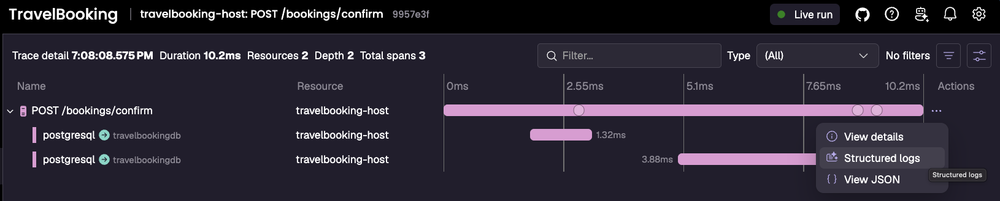
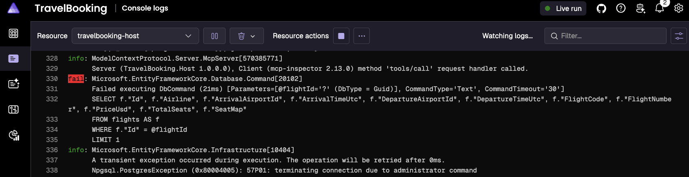
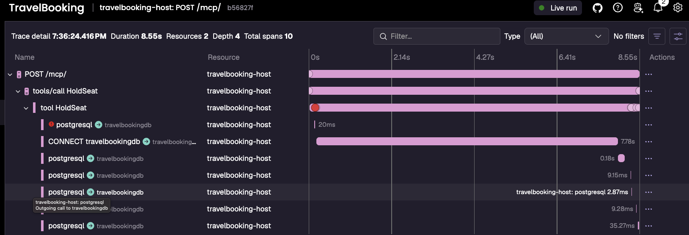

# Lab 4 — Make It Resilient (Gate 4)

In this lab you will turn reality up. Using Microsoft **Dev Proxy** you'll inject latency,
rate limits and outages into the path between client and server, watch the seat-hold
cascade fail, and then fix the system: safe retries through **idempotency**, transient
database failures handled by **EF Core's retry strategy**, and proof of all of it in the
trace.

> ⏱ Expected time: ~45 minutes.
> Prerequisite: [Lab 3](lab-03-make-it-observable.md) completed — you'll need the trace.
> Catching up? `./labs/prepare-lab.sh 4` puts the code exactly where this lab starts.
> Done? `./labs/prepare-lab.sh check 4` diffs your tree against the finished state of this lab.

## Make the failure window real

The seat hold currently expires after 5 minutes — too long to demonstrate a cascade in a
lab. Production timing pressure, scaled down: the Host folder has **two** settings files,
and this change goes into the *Development* one. Open it by name so you cannot pick the
wrong file:

```bash
code src/TravelBooking.Host/appsettings.Development.json
```

Before you edit, it holds only a `Logging` section. If you see `AllowedHosts` or
`AzureMonitor`, you are in `appsettings.json`, the file `deploy.sh` wrote the Application
Insights connection string into — close it and open the Development file. Add the
`BookingOptions` section so the file looks like this:

```json
{
  "Logging": {
    "LogLevel": {
      "Default": "Information",
      "Microsoft.AspNetCore": "Warning"
    }
  },
  "BookingOptions": {
    "SeatHoldDurationMinutes": 1
  }
}
```

> **Check the nesting.** `BookingOptions` must be a *sibling* of `Logging`, at the same
> indent. Dropped one level down, inside `Logging`, it is still valid JSON and the server
> starts without complaint — the setting is simply never read and holds stay at 5 minutes.
> A quick test: `grep -n SeatHoldDurationMinutes src/TravelBooking.Host/appsettings.Development.json`
> should report line 9 with four leading spaces.

Why the Development file: Aspire starts the Host with its `http` launch profile, which sets
`ASPNETCORE_ENVIRONMENT=Development`, so this file is layered over `appsettings.json` and
the one-minute hold applies locally. The container you deploy in Lab 6 runs as Production,
never loads this file, and keeps the 5-minute default — a lab-sized failure window should
not ship.

A held seat now expires after **one minute**. Restart Aspire:

```bash
aspire stop && aspire run
```

## Install Dev Proxy

Dev Proxy is an API simulator that sits between a client and any HTTP API and injects the
failures you can't easily produce on demand: latency, 429s, 5xx, full outages. The
Codespace installs it when it is created; check:

```bash
devproxy --version
```

If that prints nothing, install it yourself and restart your terminal (or follow the
installer's PATH hint):

```bash
bash -c "$(curl -sL https://aka.ms/devproxy/setup.sh)"
```

## Experience the cascade

The lab ships two ready-made Dev Proxy configurations in `labs/assets/lab-04/`:
`latency.json` (3–10 seconds of delay on every response) and `throttling.json` (50% of
requests answered with 429/503). Start with latency:

```bash
cd labs/assets/lab-04
devproxy --config-file latency.json
```

Leave it running. Dev Proxy listens on `127.0.0.1:8000` as an HTTP proxy and intercepts
traffic to `http://localhost:5197/*` — your server.

> **Why we drive this from the Codespace and not from the agent.** Dev Proxy is a
> *forward* proxy: it only sees traffic from clients that have been told to route through
> it, which is what `curl -x` does below. Your Foundry agent makes a direct HTTPS call to
> a public URL from inside Azure and will never honour a proxy setting on your machine.
>
> So in this lab **you** play the agent — same calls, same order, with faults in the path.
> Then at the end you hand the result to the real agent and watch it deal with the mess
> you made. That split is not a workaround: injecting faults where you control the client
> and observing behaviour where you don't is how you'd test this for real.

Now play the role of the agent, with the proxy in the path. In a third terminal, hold a
seat (any free seat). A new terminal has no `FLIGHT_ID` yet, so set it again first, as you
did in Lab 0:

```bash
FLIGHT_ID=$(curl -s "http://localhost:5197/flights?from=AMS&to=LHR&date=2026-11-21" | jq -r '.[0].id')
echo "FLIGHT_ID=$FLIGHT_ID"

curl -x http://127.0.0.1:8000 -s -X POST http://localhost:5197/bookings/hold \
  -H "Content-Type: application/json" \
  -d "{\"flightId\": \"$FLIGHT_ID\", \"seatNumber\": \"14C\"}" | jq
```

The `echo` should print a GUID after `FLIGHT_ID=`. If it prints nothing or `null`, the
search found no flight (is Aspire running?) and the hold below it cannot work.

> Note that we pipe the result to `jq` for pretty-printing the result.

Feel that pause? That's 3–10 injected seconds. The response still arrives — with an
`expiresAtUtc` **one minute** out.

An agent now does its thing: reasons about the result, maybe asks the user to confirm,
makes another tool call or two… simulate that by simply waiting a bit more than a minute.
Then confirm (paste the `holdId` from the response):

```bash
HOLD_ID=<paste the holdId here>

curl -x http://127.0.0.1:8000 -s -X POST http://localhost:5197/bookings/confirm \
  -H "Content-Type: application/json" \
  -d "{\"holdId\": \"$HOLD_ID\"}" | jq
```

```json
{"code":"booking_rule_violation","message":"Hold <HOLD_ID> expired at 2026-11-20T09:31:02.4471890Z."}
```

There's the cascade from the chapter: **latency injected → hold expires → confirm fails.**
Nothing in the code is "wrong" — it just met production conditions.

Now open the Aspire dashboard, go to **Traces** and open `POST /bookings/confirm`. Reading
it is a small lesson in what a trace does and does not hold:

- The request span carries `http.response.status_code` = `400` and nothing else about the
  failure. No red error icon either: by HTTP convention a 400 is the *client's* mistake, so
  the ASP.NET Core instrumentation does not mark the span as an error.
- Two `postgresql` child spans show what the server did before it said no: the
  `SELECT ... FROM seat_holds` that found the hold, and an `INSERT INTO audit_entries` —
  the rejection is written to the audit log even though the request failed.

- The *reason* is not on any span. Open the **⋯** menu in the Actions column of the
  `POST /bookings/confirm` row and pick **Structured logs**: the logs page opens filtered
  to this trace id, and the entry from `BookingDomainExceptionHandler` reads
  `Booking domain rule rejected request: Hold <HOLD_ID> expired at <time>`. Log and trace
  are joined by the trace id — the Lab 3 plumbing paying off.



Put the trace's start time next to the `expiresAtUtc` the hold returned: the confirm
arrived after the hold had lapsed, with timestamps you can put in a postmortem.

> **Where did `tool HoldSeat` go?** The server has two front doors into the same
> application code. `curl` just used the REST one: `POST /bookings/hold` in
> `BookingEndpoints.cs` calls `HoldSeatHandler` directly. The Inspector and your Foundry
> agent use the MCP one: `tools/call HoldSeat` lands in `BookingTools.cs`, which calls the
> very same handler. The `tool HoldSeat` span, its tags and the error status are code
> *you* wrote in `BookingTools` in Lab 3, so they exist only on MCP traces — a REST trace
> never passes through that class. Repeat the hold and the confirm through the Inspector
> and you get the richer picture: `travelbooking.hold_expires_at` sits on `tool HoldSeat`,
> and a failed `tool ConfirmBooking` *does* carry the error status and message, because
> the `catch` you wrote in Lab 3 sets them.

> Note the failure is **clean and definitive**: a structured domain error the agent can act
> on ("the hold expired — search again and re-hold"), not a hang or a stack trace. Bounded,
> explainable failure *is* resilient behavior. For LLM clients this matters double:
> agents have hard timeouts, so an answer that arrives late is an answer that doesn't
> arrive. Latency is a reliability problem.

### Now let the agent walk into it

You have an expired hold sitting in the database. Hand it to the real client: open the
playground, start a **new thread**, and ask

```
Call the ConfirmBooking tool for hold <HOLD_ID>.
```

Be that explicit. The agent did not place this hold, so a softer "confirm my hold" can
earn you a polite "that id is not one of mine" instead of a tool call.

Either of two things can come back, and the same question can give you one today and the
other tomorrow. The first is an error box, not a chat reply:

```
An error occurred invoking 'ConfirmBooking': Hold <HOLD_ID> expired at 2026-11-03T18:07:07.5609490Z.
```

The second is a proper chat reply, written by the model after it read your error:

```
The seat hold with the ID "<HOLD_ID>" has expired and cannot be confirmed. If you would
like, I can help you search for flights and hold a new seat. Would you like me to do that?
```

Start with the error box. Read it twice. Half of it is yours: `Hold … expired at …` is the `McpException` you threw
in Lab 2, delivered verbatim. The server did its part — on the wire this is a `tools/call`
*result* with `isError: true` and your message as its content, which is how the MCP spec
says a tool reports a failure the caller can act on. Had it been any other exception type,
the box would read `An error occurred invoking 'ConfirmBooking'.` and nothing else.

The other half is the host's. When you get the error box, Foundry's agent runtime ended
the run on the `isError` result instead of handing the text back to the model, so the
agent never got the chance to say "that hold expired — shall I search and re-hold?". Other
developers have
[reported the same](https://learn.microsoft.com/en-us/answers/questions/6036899/foundry-agent-service-mcp-tool-result-with-iserror);
the classic Foundry API did pass tool errors to the model.

When you get the chat reply, the host did hand the text back, and you can see what the
model made of it: the same fact your message stated (the hold expired), and a sensible
next step. Hosts differ here, one host can differ from one run to the next, and you do not
control the host.

What you do control is the message, and that is the lesson: **the error message is a
prompt fragment.** Where the host allows it, it is what the model reasons from; in every
host, it is what the human reads. `Hold X expired at T` tells either of them what to do
next; `Object reference not set to an instance of an object` is a dead end for both.

## The retry trap

Switch Dev Proxy to throttling mode. It reads its config file only at startup, so go to
the terminal where it is still running with `latency.json`, stop it with `Ctrl+C`, and
start it again with the other file:

```bash
devproxy --config-file throttling.json
```

Call the search endpoint a few times through the proxy:

```bash
curl -x http://127.0.0.1:8000 -s -w "\nHTTP %{http_code}\n" \
  "http://localhost:5197/flights?from=AMS&to=LHR&date=2026-11-21"
```

Roughly half your calls come back `HTTP 429` (back-pressure from the server to the client, with a `Retry-After` header) or `HTTP 503` (Server Error).
Mind that `Retry-After: 5`: Dev Proxy's `RetryAfterPlugin` remembers it and answers **every**
call to the server in those five seconds with another 429, whatever the random rate says,
exactly as a real throttled API would. A tight loop of retries therefore sees nothing but
429s; pace your calls and wait out the `Retry-After` before the next one.

The obvious client reaction is to retry. For `SearchFlights`, retrying is harmless — read
operations are naturally safe. A 429 is harmless to retry as well, whatever the operation:
it is the server telling you it did *not* process the request, so nothing has happened yet.
The dangerous case is the one with **no answer at all**: a timeout, a dropped connection,
a 502 or 504 from a proxy that gave up waiting while the server was already doing the
work. From the client's side those all collapse into one question — *did it happen?* —
and the agent cannot tell. Hold a seat and pretend the *response* got lost that way:

```bash
curl -x http://127.0.0.1:8000 -s -X POST http://localhost:5197/bookings/hold \
  -H "Content-Type: application/json" \
  -d "{\"flightId\": \"$FLIGHT_ID\", \"seatNumber\": \"15D\"}" | jq
```

Repeat (waiting out any `Retry-After`) until you've seen one succeed; then — as the
retrying agent would — run the exact same command again:

```json
{"code":"booking_rule_violation","message":"Seat 15D is currently held."}
```

The retry **fails because the first attempt succeeded.** The agent now believes the seat is
taken by someone else and books a different one — and your customer ends up with two held
seats, or the wrong seat. The operation succeeded on the server, failed in the client's
view, and the retry made things *worse*. This is the double-booking problem, and no retry
policy fixes it. The fix is a design property: **idempotency** — the same request, repeated,
must produce the same result, not a new side effect.

Stop Dev Proxy (`Ctrl+C`).

## Make HoldSeat idempotent

To recognize a *repeat* of the same request, the server needs to know who is asking. The
`SeatHold` entity already has a `UserId` for this. Open
`src/TravelBooking.Domain/Models/Flight.cs` and replace the whole `HoldSeat` method with
the version below. Only the six lines under the `// Idempotency:` comment are new, inside
the `if (activeHold is not null)` block; the rest is what you already have:

```csharp
    public HoldSeatResult HoldSeat(string seatNumber, string? userId, DateTime nowUtc, HoldPolicy policy, FlightOccupancy occupancy)
    {
        if (occupancy.Holds.Any(h => h.FlightId != Id) || occupancy.Bookings.Any(b => b.FlightId != Id))
        {
            throw new ArgumentException("Occupancy snapshot belongs to a different flight.", nameof(occupancy));
        }

        if (string.IsNullOrWhiteSpace(seatNumber))
        {
            throw new BookingDomainException($"A seat number is required on flight {FlightCode}.");
        }

        seatNumber = seatNumber.Trim().ToUpperInvariant();

        if (HasDeparted(nowUtc))
        {
            throw new BookingDomainException($"Flight {FlightCode} has already departed.");
        }

        if (!HasSeat(seatNumber))
        {
            throw new BookingDomainException($"Seat {seatNumber} does not exist on flight {FlightCode}.");
        }

        // Retire expired-but-still-Active holds on this seat so the unique partial index lets it be
        // re-held. Only this seat: a wider sweep races with concurrent confirmations of other seats.
        foreach (var expired in occupancy.Holds.Where(h => h.SeatNumber == seatNumber && h.Status == HoldStatus.Active && !h.IsActive(nowUtc)))
        {
            expired.MarkExpired(nowUtc);
        }

        if (occupancy.Bookings.Any(b => b.SeatNumber == seatNumber && b.Status == BookingStatus.Confirmed))
        {
            throw new BookingDomainException($"Seat {seatNumber} is already booked.");
        }

        var activeHold = occupancy.Holds.FirstOrDefault(h => h.SeatNumber == seatNumber && h.IsActive(nowUtc));
        if (activeHold is not null)
        {
            // Idempotency: the same caller re-requesting the same seat gets the same hold
            // back, instead of a conflict. Retries become safe.
            if (activeHold.IsOwnedBy(userId))
            {
                return new HoldSeatResult(activeHold, Created: false);
            }

            throw new BookingDomainException($"Seat {seatNumber} is currently held.");
        }

        if (userId is not null)
        {
            var heldByCaller = occupancy.Holds.Count(h => h.IsActive(nowUtc) && h.IsOwnedBy(userId));
            if (heldByCaller >= policy.MaxActiveHoldsPerCaller)
            {
                throw new BookingDomainException(
                    $"Caller already holds {heldByCaller} seats on flight {FlightCode}; the maximum is {policy.MaxActiveHoldsPerCaller}.");
            }
        }

        var expiresAtUtc = nowUtc.Add(policy.Duration);
        if (expiresAtUtc > DepartureTimeUtc)
        {
            expiresAtUtc = DepartureTimeUtc;
        }

        return new HoldSeatResult(SeatHold.Create(this, seatNumber, userId, nowUtc, expiresAtUtc), Created: true);
    }
```

> Placement matters here. Above the `if (activeHold is not null)` block is a loop that
> calls `MarkExpired` on holds that are expired-but-still-`Active`. The new check runs
> **after** that cleanup, or it could hand back a hold that has already timed out —
> turning an idempotency feature into a way to resurrect dead holds.

Idempotency is a business rule, so it lives beside the other booking rules in the domain,
not in a service. That is why both the REST endpoint and the MCP tool get it for free, and
why nothing in `BookingService` changes for `HoldSeat`.

While you're here, make confirming idempotent too — a confirm retry should return the
booking that already exists, not an error. The rule goes where the `HoldSeat` rule went:
into the domain. Open `src/TravelBooking.Domain/Models/SeatHold.cs` and replace the whole
`Confirm` method with the version below. New is the block at the top: an already-confirmed
hold hands back the booking that confirmation created, after the same ownership check a
first confirm runs. The `ConfirmResult` it returns mirrors `HoldSeatResult` — its `Created`
flag tells the caller whether anything new came into existence:

```csharp
    public ConfirmResult Confirm(string? userId, DateTime nowUtc, string bookingReference)
    {
        // Idempotency: the owner confirming an already-confirmed hold gets the booking that
        // confirmation created, instead of a conflict. Retries become safe.
        if (Status == HoldStatus.Confirmed && ConfirmedAsBooking is not null)
        {
            OwnershipRule.EnsurePermits(UserId, userId, "confirm this hold");
            return new ConfirmResult(ConfirmedAsBooking, Created: false);
        }

        if (Status != HoldStatus.Active)
        {
            throw new BookingDomainException($"Hold {Id} is not active (status: {Status}).");
        }

        if (ExpiresAtUtc <= nowUtc)
        {
            throw new BookingDomainException($"Hold {Id} expired at {ExpiresAtUtc:o}.");
        }

        OwnershipRule.EnsurePermits(UserId, userId, "confirm this hold");

        var booking = Booking.Create(this, userId ?? UserId, nowUtc, bookingReference);
        Status = HoldStatus.Confirmed;
        ConfirmedAsBookingId = booking.Id;
        ConfirmedAsBooking = booking;
        return new ConfirmResult(booking, Created: true);
    }
```

The service has no rule to add, only two persistence chores. The domain can only hand back
a booking it can see, so the hold is loaded *with* its booking (`Include`); and a replayed
confirm must not be written twice, so the booking is added to the context only when
`Created` says it is new — the same `if (result.Created)` shape `HoldSeatAsync` already
has. Open `src/TravelBooking.Infrastructure/Services/BookingService.cs` and replace the
whole `ConfirmBookingAsync` method with the version below:

```csharp
    public async Task<Booking> ConfirmBookingAsync(
        Guid holdId,
        string? userId,
        CancellationToken cancellationToken)
    {
        // Load the booking an earlier confirm may have created, so the domain can hand it back.
        var hold = await db.SeatHolds
            .Include(h => h.ConfirmedAsBooking)
            .FirstOrDefaultAsync(h => h.Id == holdId, cancellationToken)
            ?? throw new BookingDomainException($"Hold {holdId} not found.");

        var now = clock.GetUtcNow().UtcDateTime;
        var result = hold.Confirm(userId, now, BookingReference.Generate());
        var booking = result.Booking;
        if (!result.Created)
        {
            return booking;
        }

        db.Bookings.Add(booking);

        for (int attempt = 1; attempt <= BookingReferenceRetryAttempts; attempt++)
        {
            try
            {
                await db.SaveChangesAsync(cancellationToken);
                return booking;
            }
            catch (DbUpdateException ex) when (IsUniqueViolation(ex) && IsBookingReferenceConflict(ex))
            {
                if (attempt == BookingReferenceRetryAttempts)
                {
                    throw new BookingDomainException(
                        "Could not generate a unique booking reference after several attempts.", ex);
                }
                booking.ReassignReference(BookingReference.Generate());
            }
            catch (DbUpdateException ex) when (IsUniqueViolation(ex))
            {
                throw new BookingDomainException(
                    $"Seat {hold.SeatNumber} was booked by another request.", ex);
            }
        }

        return booking;
    }
```

> Before Lab 5, `OwnershipRule` tolerates anonymous callers: an unowned hold may be
> confirmed by anyone, and replayed by anyone. The flow in this lab is unchanged.

Note the design choice in `HoldSeat`: idempotency is keyed on the **caller's
identity**. Two *different* anonymous customers fighting over seat 15D should still
conflict — that's correct behavior, not a bug. Which raises a question: where does
`userId` come from? Until Lab 5 gives us authenticated callers, we let the *client* supply
a customer id through the tool schema. Open `src/TravelBooking.MCP/Tools/BookingTools.cs`
and replace the whole `HoldSeatAsync` method, attributes included, with the version below.
New are the `customerId` parameter at the end of the signature (optional — an additive
schema change, so existing clients keep working) and the `userId:` argument in the
`HandleAsync` call, which treats an empty string as "not supplied" so the anonymous path
behaves as it did:

```csharp
    [McpServerTool(Name = "HoldSeat")]
    [Description("Places a temporary hold on a specific seat of a flight. The hold expires " +
        "after a few minutes; confirm it with ConfirmBooking before it expires. " +
        "Returns the hold id and the exact UTC expiration time.")]
    public async Task<HoldResult> HoldSeatAsync(
        [Description("The flight id returned by SearchFlights.")] Guid flightId,
        [Description("The seat number to hold, e.g. '12A'. Must be one of the available " +
            "seats returned by GetFlightDetails.")] string seatNumber,
        CancellationToken cancellationToken,
        [Description("A stable identifier for the customer making the booking, e.g. an " +
            "email address. Always pass the same value when retrying a failed call.")]
        string customerId = "")
    {
        using var activity = McpTelemetry.ActivitySource.StartActivity("tool HoldSeat");
        activity?.SetTag("gen_ai.operation.name", "execute_tool");
        activity?.SetTag("gen_ai.tool.name", "HoldSeat");
        activity?.SetTag("travelbooking.flight_id", flightId);
        activity?.SetTag("travelbooking.seat_number", seatNumber);

        try
        {
            var hold = await holdSeat.HandleAsync(
                flightId, seatNumber,
                userId: string.IsNullOrWhiteSpace(customerId) ? null : customerId,
                cancellationToken);
            activity?.SetTag("travelbooking.hold_id", hold.HoldId);
            activity?.SetTag("travelbooking.hold_expires_at", hold.ExpiresAtUtc.ToString("o"));
            McpTelemetry.SeatsHeld.Add(1);
            return hold;
        }
        catch (BookingDomainException ex)
        {
            activity?.SetStatus(ActivityStatusCode.Error, ex.Message);
            logger.LogWarning(ex, "HoldSeat failed for flight {FlightId}, seat {SeatNumber}: {Reason}",
                flightId, seatNumber, ex.Message);
            throw new McpException(ex.Message);
        }
    }
```

> Why `string customerId = ""` rather than the more natural `string? customerId = null`?
> Because a nullable parameter can surface in the generated JSON schema as
> `"type": ["string", "null"]`, and the Azure AI Foundry Agent Service **rejects
> any tool schema containing a multi-type parameter** — it fails the whole tool
> list with "Invalid tool schema", not just this one tool. An empty-string
> sentinel keeps the schema single-typed. It is a small ugliness caused by a
> client limitation, and it disappears in Lab 5 when a verified identity
> replaces this parameter entirely.

> A model-supplied customer id is a stopgap, and you should be squirming a little: the LLM
> *makes up* this value, and we're trusting it. Hold that thought — replacing this
> parameter with a cryptographically verified identity is literally the next lab.

## Prove it with a test

The repo's test suite guards the booking rules — so our new rule gets a test too. Add this
at the end of the class in `src/tests/TravelBooking.Tests/Infrastructure/BookingServiceTests.cs`:

```csharp
    [Fact]
    public async Task HoldSeat_returns_same_hold_when_same_user_retries()
    {
        var (svc, _, _, flight) = Setup();

        var first = await svc.HoldSeatAsync(flight.Id, "1A", userId: "user-42", CancellationToken.None);
        var retry = await svc.HoldSeatAsync(flight.Id, "1A", userId: "user-42", CancellationToken.None);

        retry.Id.Should().Be(first.Id);
    }

    [Fact]
    public async Task HoldSeat_still_rejects_different_user_for_held_seat()
    {
        var (svc, _, _, flight) = Setup();

        await svc.HoldSeatAsync(flight.Id, "1A", userId: "user-42", CancellationToken.None);
        var act = async () => await svc.HoldSeatAsync(flight.Id, "1A", userId: "user-43", CancellationToken.None);

        await act.Should().ThrowAsync<BookingDomainException>();
    }

    [Fact]
    public async Task ConfirmBooking_returns_same_booking_when_retried()
    {
        var (svc, _, _, flight) = Setup();
        var hold = await svc.HoldSeatAsync(flight.Id, "1A", userId: null, CancellationToken.None);

        var first = await svc.ConfirmBookingAsync(hold.Id, userId: null, CancellationToken.None);
        var retry = await svc.ConfirmBookingAsync(hold.Id, userId: null, CancellationToken.None);

        retry.Id.Should().Be(first.Id);
        retry.BookingReference.Should().Be(first.BookingReference);
    }
```

Those three exercise the rule through the service, the way a client meets it. The rule
itself lives in the domain, though, so its own test belongs next to the other `Flight`
rules in `src/tests/TravelBooking.Tests/Domain/FlightTests.cs`. Add it at the end of that class — no
database, no mocks, just the entity and a snapshot of what's already held:

```csharp
    [Fact]
    public void HoldSeat_returns_existing_hold_for_same_named_caller()
    {
        var flight = NewFlight();
        var first = flight.HoldSeat("1A", "alice", Now, Policy, FlightOccupancy.Empty).Hold;

        var retry = flight.HoldSeat("1A", "alice", Now, Policy, new FlightOccupancy([first], []));

        using var _ = new AssertionScope();
        retry.Created.Should().BeFalse();
        retry.Hold.Should().BeSameAs(first);
    }
```

`SeatHold` carries a rule of its own now, so it gets the same treatment in
`src/tests/TravelBooking.Tests/Domain/SeatHoldTests.cs`. One existing test there,
`Confirm_rejects_hold_that_is_not_active`, confirmed the same hold twice and expected a
conflict. See what your change did to it before you touch it — run just that test:

```bash
dotnet test TravelBooking.slnx --filter-method "*Confirm_rejects_hold_that_is_not_active"
```

```
failed TravelBooking.Tests.Domain.SeatHoldTests.Confirm_rejects_hold_that_is_not_active
  Expected a <TravelBooking.Domain.BookingDomainException> to be thrown, but no exception was thrown.
```

It fails for the right reason: the second confirm is now a replay, and a replay returns
the booking instead of throwing. The test described the old behaviour, not a bug. Keep
its intent (a hold that is not active cannot be confirmed) by expiring the hold instead,
and add the two tests for the new rule beneath it. Replace that one test with these
three:

```csharp
    [Fact]
    public void Confirm_rejects_hold_that_is_not_active()
    {
        var hold = NewHold("alice");
        hold.MarkExpired(hold.ExpiresAtUtc);

        var act = () => hold.Confirm("alice", Now.AddMinutes(1), "BKG-TEST01");

        act.Should().Throw<BookingDomainException>().WithMessage("*not active*");
    }

    [Fact]
    public void Confirm_returns_the_existing_booking_when_the_owner_confirms_again()
    {
        var hold = NewHold("alice");
        var first = hold.Confirm("alice", Now.AddMinutes(1), "BKG-TEST01");

        var retry = hold.Confirm("alice", Now.AddMinutes(2), "BKG-TEST02");

        using var _ = new AssertionScope();
        retry.Created.Should().BeFalse();
        retry.Booking.Should().BeSameAs(first.Booking);
    }

    [Fact]
    public void Confirm_rejects_a_different_caller_confirming_again()
    {
        var hold = NewHold("alice");
        hold.Confirm("alice", Now.AddMinutes(1), "BKG-TEST01");

        var act = () => hold.Confirm("bob", Now.AddMinutes(2), "BKG-TEST02");

        act.Should().Throw<BookingDomainException>().WithMessage("Only the owner may confirm this hold.");
    }
```

Run the same filtered command again — one test, green. Then the whole suite:

```bash
dotnet test TravelBooking.slnx
```

All tests should pass — the existing ones (anonymous double-hold still conflicts, expired
holds still rejected) *and* your six new ones. Retries are now safe by design. (The
`LabPatchesTests` repository checks report themselves as skipped while your tree is
mid-lab; that is expected.)

If you want to feel it end-to-end: restart Aspire and call `HoldSeat` twice through the
Inspector with the same `customerId` — the same `holdId` comes back both times. The REST
endpoints take the caller from the authenticated identity instead, which is Lab 5's
business.

## Transient database failures

So far the failures came from *outside*. Now the database has a bad moment:

1. In the Aspire dashboard, find the `postgres` resource, open its **⋮** actions menu, and
   click **Stop**.

2. Search for flights, with the `SearchFlights` tool in the Inspector or with curl (no
   proxy needed):

   ```bash
   curl -s "http://localhost:5197/flights?from=AMS&to=LHR&date=2026-11-21" | jq
   ```

   Nothing comes back. The call hangs until the client gives up: the Inspector hits its
   request timeout and shows the connection as dropped; stop curl with `Ctrl+C`.

3. Back in the dashboard, open the **⋮** menu of `postgres` again and click **Start**.

4. Repeat the search (reconnect the Inspector first). It succeeds.

A stopped container is a hard outage. But the common production case is *transient*: a
connection blip, a failover, a brief saturation — gone 200 ms later. EF Core has a
built-in answer: an **execution strategy** that retries transient failures with exponential
backoff. Switch it on:

```bash
code src/TravelBooking.Host/Program.cs
```

First add the using directive at the top of the file (it sorts before the existing ones) —
`UseNpgsql` is an extension method and the file does not import its namespace yet:

```csharp
using Microsoft.EntityFrameworkCore;
```

Then replace the `AddNpgsqlDbContext` line:

```csharp
builder.AddNpgsqlDbContext<TravelBookingDbContext>(
    connectionName: "travelbookingdb",
    configureDbContextOptions: options => options.UseNpgsql(npgsql =>
        npgsql.EnableRetryOnFailure(
            maxRetryCount: 5,
            maxRetryDelay: TimeSpan.FromSeconds(10),
            errorCodesToAdd: null)));
```

Every EF operation is now wrapped in a retry strategy that recognizes transient
PostgreSQL error codes (and *only* those — a constraint violation will never be retried).

Re-run the outage experiment, this time with better timing:

1. Restart Aspire:

   ```bash
   aspire stop && aspire run
   ```

2. Run one search while the database is still up, so the Host has a pooled connection for
   the outage to kill:

   ```bash
   curl -s "http://localhost:5197/flights?from=AMS&to=LHR&date=2026-11-21" | jq
   ```

3. In the dashboard, stop `postgres` (**⋮** → **Stop**).

4. Run the same search again. It does not return yet; leave it waiting.

5. **Within a few seconds**, start `postgres` again (**⋮** → **Start**).

The call that would have failed comes back successful — it was retrying under the hood.
You can watch it in both places you learned in Lab 3:

- **Logs.** Open the **Console logs** of `travelbooking-host` (**Structured logs** shows
  the same entries). The first attempt fails with
  `57P01: terminating connection due to administrator command` — the pooled connection
  was killed when postgres shut down — and EF answers at Information level:
  `A transient exception occurred during execution. The operation will be retried after 0ms.`

  

- **Traces.** Open the trace of the call. The screenshot shows the same outage hitting a
  `HoldSeat` call; a search looks the same, minus the tool spans. The failed attempt is a `postgresql` span
  marked red, followed by a long `CONNECT` span — that is the retry waiting for postgres
  to come back — and then the query that succeeds:

  

> Why retry *here* and not wrap the whole tool in a retry? Because the closer the retry is
> to the transient resource, the smaller the blast radius: an EF retry repeats one query;
> a tool-level retry would repeat the entire use case — audit log writes included. Retry
> narrow, retry transient-only, and keep the attempts bounded.

## Stretch goals

If you're ahead of the room:

- **Timeout budget.** Add ASP.NET Core's request-timeout middleware
  (`builder.Services.AddRequestTimeouts(...)` + `app.UseRequestTimeouts()`) with a default
  policy of ~10 seconds, so no tool call can ever hold a connection hostage indefinitely.
  Verify with the latency proxy in front of the *database*-heavy `SearchFlights`.
- **Throttling-aware client.** Write a small script that calls the REST API through the
  throttling proxy and honors `Retry-After` with exponential backoff + jitter — the
  client half of the resilience contract. (`Microsoft.Extensions.Http.Resilience` gives
  .NET HttpClients this behavior in one line: `AddStandardResilienceHandler()` — which
  this solution's ServiceDefaults already applies to outgoing HttpClients.)
- **Bound the seat-map query.** `GetFlightDetails` returns *every* available seat. What
  happens to the response size — and the LLM's context window — on a 320-seat flight?
  Resilience includes not flooding your caller.

## Gate closed ✅

> ☑ Work ☑ Debuggable ☑ Observable ☑ **Resilient** ☐ Secure ☐ Deployable

Your server now survives latency storms, throttling, lost responses, and database blips —
and where it can't succeed, it fails fast, clean, and explainable, with the trace to prove
it. One glaring problem left: *anyone* can call it, and the "customer id" is whatever the
model says it is. Time to find out who's really knocking.

---

*Next up: [Lab 5 — Make It Secure](lab-05-make-it-secure.md).*
