# Lab 5 — Make It Secure (Gate 5)

In this lab you will close the most uncomfortable gap in your server: **anyone can call
it**. You'll protect the `/mcp` endpoint with OAuth 2.1 + PKCE against a **Duende
IdentityServer** running right inside Aspire, gate the booking tools behind a scope, and
replace Lab 4's model-supplied customer id with a *verified* identity that flows into the
audit log and the trace.

> ⏱ Expected time: ~45 minutes.
> Prerequisite: [Lab 4](lab-04-make-it-resilient.md) completed.
> Catching up? `./labs/prepare-lab.sh 5` puts the code exactly where this lab starts.
> Done? `./labs/prepare-lab.sh check 5` diffs your tree against the finished state of this lab.

<!-- INSTRUCTOR NOTE (Loek/Alex): this lab assumes the AppHost is pre-wired with a
     Duende IdentityServer project resource. The contract the lab steps rely on:
     - Aspire resource name "identity-server", reachable from the Codespace on port 5001
       (set in src/TravelBooking.IdentityServer/Properties/launchSettings.json)
     - In-memory config (Config.cs) with:
       * public PKCE client "mcp-inspector": authorization_code grant only,
         redirect URIs covering common local dev ports
       * API scopes "mcp:tools" (default) and "booking:write" (optional — only issued when requested)
       * API resource "travelbooking-mcp" (becomes the token audience)
       * test users alice / alice123 and bob / bob123
     - The Host receives "Authentication:Authority" = the IS endpoint URL via AppHost
       WithEnvironment (http://localhost:5001 locally), but ONLY when "UseIdentityServer"
       is true in the AppHost's appsettings.json. Labs 0-4 ship it as false so the
       Foundry agent -- which cannot do OAuth -- can call /mcp anonymously; this lab
       flips it to true and the lab patches flip it back for earlier labs. If an
       attendee's Lab 0 agent returns 401, check that setting.
     Adjust port if the actual launchSettings differs.

     INTERACTIVE LOGIN (closes issue #6): the IdP now ships Duende's quickstart UI
     (pruned to login / logout / consent / error) plus a dev-only token page at
     http://localhost:5001/Token. That page is itself a public PKCE client: it runs a
     real authorization code + PKCE flow against the IdP it lives in, and renders the
     access token for copy-paste.

     The hard part is that the origin the browser uses is NOT knowable at startup, and
     it differs in all four shapes this runs in: plain `dotnet run` (localhost:5001);
     behind Aspire's endpoint proxy (the process binds a port Aspire picked, the browser
     uses the published one); a dev container, which is localhost under VS Code Desktop
     but a *.devtunnels.ms host when the editor runs in a browser; and a Codespace, on a
     per-attendee *.app.github.dev host. Duende rightly refuses wildcard redirect URIs,
     so three mechanisms cover it, in order:
       - WorkshopUrls.FromEnvironment() registers every origin it CAN predict -- the
         bind address, IdentityServer__PublicOrigin (which AppHost.cs hands it from
         identityServer.GetEndpoint("http")), and the CODESPACE_NAME-derived hostnames.
       - DevelopmentRedirectUriValidator accepts the rest, but only a known callback
         path on a host the browser could plausibly be on, and only per client -- Inspector
         cannot claim the token page's callback. "Plausibly" is deliberately narrow:
         localhost, or the SAME tenant as the request being served on a port-forwarding
         domain. Matching *.app.github.dev by suffix would be a wildcard redirect URI in
         disguise, since every GitHub user has a host there and could collect a code from
         an attendee who followed their link. TryGetForwardedTenant() reduces
         "my-space-6274.app.github.dev" and "my-space-5001.app.github.dev" to the same
         tenant and "somebody-else-6274.app.github.dev" to a different one.
         DevelopmentCorsPolicyService does the same for Inspector's browser-side code
         exchange. Both are Development-only; the IdP refuses to start otherwise.

     ISSUER IN A CODESPACE -- when CODESPACE_NAME is set the issuer is pinned to the
     browser-facing https://<codespace>-5001.app.github.dev, NOT to Aspire's published
     http://localhost:5001. A browser-based client such as Inspector is handed the
     authorization endpoint from discovery, and localhost there means the attendee's own
     machine, not the Codespace. The MCP server fetches discovery and JWKS over loopback
     (Authentication:Authority) and validates a token's `iss` against the `issuer` in that
     document, so the two only have to agree with each other. Its resource metadata
     names the authorization server by that same `issuer`, not by Authority: Inspector
     enforces RFC 8414 §3.3 ("Issuer mismatch in authorization server metadata") and
     would refuse http://localhost:5001 when the document says the Codespace hostname.
       - IdentityServer__ExtraOrigins=<origin> is the escape hatch for a setup nobody
         anticipated. Every accepted origin is logged on startup, and every rejected
         redirect_uri is logged with the reason -- that log line is the answer to an
         attendee reporting "Invalid redirect_uri".
       - DevelopmentResourceIndicatorValidator maps an RFC 8707 resource parameter that
         names the MCP server by URL (what Inspector/VS Code send, taken from the server's
         resource metadata) to the "travelbooking-mcp" API resource. Without it Duende
         answers invalid_target ("Invalid resource indicator"). Its counterpart
         DevelopmentResourceIndicatorTokenRequestValidator redoes Duende's resource
         isolation filter at the token endpoint with the mapped name; without THAT the
         access token has no aud and only offline_access as scope, the MCP server answers
         401, and Inspector loops on refreshes until "Unexpected: auth() returned
         AUTHORIZED without authorization code". The Inspector client also allows
         offline_access, because Inspector requests it by default.
     IdentityServerOptions.IssuerUri is PINNED (to PublicOrigin when known, the bind
     address otherwise), because the IdP is reached on two origins at once: loopback for
     the MCP server's discovery and JWKS fetch, and the browser's host. Without pinning,
     `iss` would vary by door and the Host would reject half the tokens we issue.

     COOKIES -- three settings in Program.cs are load-bearing and all fail silently if
     removed. (0) AddDataProtection().PersistKeysToFileSystem(keys/). Without it the key
     ring is in-memory, so restarting the IdP invalidates everything it previously
     encrypted: attendees are signed out, and any authorization already in flight comes
     back from the token page as "the flow cookie could not be decrypted". Under Aspire a
     rebuild restarts the process, so this happens whenever someone edits code mid-lab and
     resumes a tab they had open -- it presents as an intermittent, unreproducible failure. (1) options.Authentication.CookieSameSiteMode = SameSiteMode.Lax. Duende
     defaults it to None, and a browser REJECTS a SameSite=None cookie that is not also
     Secure -- it is never stored, so login appears to do nothing and bounces back to an
     empty form with no error in the browser or the logs. The IdP serves plain http, so
     None is unusable; Lax is correct for an authorization code flow anyway, since the
     callback is a top-level GET navigation. CheckSessionCookieSameSiteMode is set to Lax
     for the same reason. (2) The forwarded-header middleware below.

     FORWARDED HEADERS -- do not replace the middleware in Program.cs with
     app.UseForwardedHeaders(). It cannot make the distinction that matters here, and
     getting it wrong fails silently. Codespaces and dev tunnels really do terminate TLS
     in front of us and send X-Forwarded-Proto: https, which we must honour or the token
     page builds an http:// redirect URI while the browser is on https://. But Aspire's
     endpoint proxy sends that header too, on localhost, where it is false. Honour it
     there and Request.IsHttps becomes true, Duende marks the idsrv cookie Secure, and a
     browser on plain http://localhost:5001 refuses to send it back -- so the attendee
     logs in, is redirected to /connect/authorize/callback as an anonymous caller, and
     lands back on an EMPTY LOGIN FORM with no error in the logs or the browser. The
     middleware therefore trusts X-Forwarded-Host always (an origin we cannot use is
     rejected downstream anyway) but trusts X-Forwarded-Proto only when the resulting
     host is one that actually fronts us with TLS -- WorkshopUrls.TerminatesTlsInFront.
     TESTING THESE -- a scripted client built on Python's http.cookiejar (or anything
     similar) will NOT catch either cookie bug: it ignores both the Secure flag and the
     SameSite=None-requires-Secure rule, so it sails through flows that loop forever in a
     real browser. Both bugs shipped once for exactly that reason. Any harness for this
     has to reject SameSite=None-without-Secure and withhold Secure cookies over http.
     Port 5001 is made public in postStartCommand for Inspector's cross-origin token
     exchange; the token page itself redeems server-side and does not need it.
     The resource-owner-password grant is GONE from both clients -- it is removed in
     OAuth 2.1, and the lab no longer needs it. Both clients also set RequireConsent =
     true with AllowRememberConsent = false, so step 5's scope demo works by unchecking
     a box on the consent screen and can be repeated. -->

## See the problem first

Your server from Lab 4 has timeouts, retries, idempotency — and absolutely no idea who is
calling it. Since Lab 0 it has been on the public internet on a published Codespace port;
anyone with that URL could have booked, cancelled, and re-booked every seat in the
database — and an agent in Azure has been doing exactly that all day. And the
research is blunt about how common this is: about half of deployed MCP servers still ship
with long-lived static API keys or nothing at all, while the MCP specification expects
**OAuth 2.1 with PKCE** for HTTP transports.

Today we do it the way the spec means it.

## Meet your identity provider

The AppHost runs **Duende IdentityServer** as just another Aspire project resource — check
the dashboard: with Aspire running you'll find `identity-server` listed next to
`postgres` and `travelbooking-host`, with an endpoint on port **5001**. The workshop
configuration (`src/TravelBooking.IdentityServer/Config.cs`) registers a public PKCE
client `mcp-inspector`, the scopes `mcp:tools` and `booking:write`, and two test users:

| Username | Password |
|----------|----------|
| `alice` | `alice123` |
| `bob` | `bob123` |

You can browse the discovery document to confirm everything is wired up:

```bash
curl -s http://localhost:5001/.well-known/openid-configuration | jq .
```

Duende IdentityServer has no web *admin* UI — configuration lives in `Config.cs`, which
is plain C#. Open it and have a look, but resist the urge to change anything mid-lab.

It does have an end-user UI, though: open <http://localhost:5001/> in a browser (in a
Codespace, use the forwarded URL for port 5001) and you'll find Duende's login and
consent pages, plus a **Get an access token** page. We come back to that in a few
minutes — first your server needs to start asking for one.

## Protect the endpoint

First, add the JWT bearer handler to the central package versions in
`Directory.Packages.props`. It belongs in the `Authentication` ItemGroup, next to
`Microsoft.AspNetCore.Authorization`, and takes its version from the same `$(AspnetVersion)`
property as every other ASP.NET Core package (see
[ADR 0010](../docs/adr/0010-centralized-package-management.md) for why):

```xml
    <PackageVersion Include="Microsoft.AspNetCore.Authentication.JwtBearer" Version="$(AspnetVersion)" />
```

…and reference it from `src/TravelBooking.Host/TravelBooking.Host.csproj` (no version —
that's the point of central package management):

```xml
    <PackageReference Include="Microsoft.AspNetCore.Authentication.JwtBearer" />
```

Now open `src/TravelBooking.Host/Program.cs`. Add the using directives:

```csharp
using Microsoft.AspNetCore.Authentication;
using Microsoft.AspNetCore.Authentication.JwtBearer;
using Microsoft.Extensions.Options;
using ModelContextProtocol.AspNetCore.Authentication;
using ModelContextProtocol.Authentication;
using TravelBooking.API.Authorization;
```

The wiring you are about to add is deliberately conditional on configuration: with no
authority configured (Labs 0–4, a cloud environment without an IdP, or an agent that
cannot do OAuth) the server still runs open, and says so loudly in the log. "Open" does
not mean "no authentication middleware", though — the `[Authorize]` attributes and
`RequireAuthorization()` calls you add below must keep working either way, so the open
path registers a scheme that authenticates everyone as an anonymous principal. Create
`src/TravelBooking.Host/PassThroughAuthenticationHandler.cs`:

```csharp
using System.Security.Claims;
using System.Text.Encodings.Web;
using Microsoft.AspNetCore.Authentication;
using Microsoft.Extensions.Options;

namespace TravelBooking.Host;

internal sealed class PassThroughAuthenticationHandler(
    IOptionsMonitor<AuthenticationSchemeOptions> options,
    ILoggerFactory logger,
    UrlEncoder encoder)
    : AuthenticationHandler<AuthenticationSchemeOptions>(options, logger, encoder)
{
    public const string SchemeName = "PassThrough";

    protected override Task<AuthenticateResult> HandleAuthenticateAsync()
    {
        var identity = new ClaimsIdentity(SchemeName);
        var ticket = new AuthenticationTicket(new ClaimsPrincipal(identity), Scheme.Name);
        return Task.FromResult(AuthenticateResult.Success(ticket));
    }
}
```

One more helper before the wiring itself. A token carries the scopes the user granted in
its `scope` claim, and that claim arrives in one of two shapes: a JSON array, which the
bearer handler turns into **one `scope` claim per scope**, or a single space-delimited
string. Checking only the first claim is a classic bug: it works for a token whose first
scope happens to be the one you want and silently fails for every other order. Create
`src/TravelBooking.API/Authorization/ScopeClaims.cs` with an extension that looks at all
of them:

```csharp
using System.Security.Claims;

namespace TravelBooking.API.Authorization;

public static class ScopeClaims
{
    /// <summary>
    /// True when the caller's token grants <paramref name="scope"/>. A JWT carries its scopes
    /// either as a JSON array, which the bearer handler turns into one <c>scope</c> claim per
    /// scope, or as a single space-delimited claim. Look at all of them, in either shape.
    /// </summary>
    public static bool HasScope(this ClaimsPrincipal user, string scope) =>
        user.FindAll("scope")
            .SelectMany(claim => claim.Value.Split(' ', StringSplitOptions.RemoveEmptyEntries))
            .Contains(scope, StringComparer.Ordinal);
}
```

Back to the Host project. Add the authentication wiring to
`src/TravelBooking.Host/Program.cs`, *above* the `builder.Services.AddMcpServer()` block:

```csharp
var oauthAuthority = builder.Configuration["Authentication:Authority"];
var mcpServerUrl = builder.Configuration["Authentication:ResourceUrl"] ?? "http://localhost:5197";

if (!string.IsNullOrWhiteSpace(oauthAuthority))
{
    ProtectedResourceMetadata ResourceMetadataFor(string authorizationServer) => new()
    {
        Resource = mcpServerUrl,
        AuthorizationServers = { authorizationServer },
        ScopesSupported = ["mcp:tools", "booking:write"],
    };

    builder.Services.AddAuthentication(options =>
    {
        options.DefaultAuthenticateScheme = JwtBearerDefaults.AuthenticationScheme;
        options.DefaultChallengeScheme = McpAuthenticationDefaults.AuthenticationScheme;
    })
    .AddJwtBearer(options =>
    {
        options.Authority = oauthAuthority;
        options.RequireHttpsMetadata = false; // dev: IdentityServer runs on plain http
        options.TokenValidationParameters = new()
        {
            ValidateAudience = true,
            ValidAudience = "travelbooking-mcp",
        };
    })
    .AddMcp(options =>
    {
        options.ResourceMetadata = ResourceMetadataFor(oauthAuthority);

        // The metadata document names the authorization server by its own issuer, not by
        // the address this server fetches discovery from. A client refuses metadata whose
        // `issuer` differs from the URL it asked for (RFC 8414 §3.3) -- Inspector does --
        // and in a Codespace the identity provider's issuer is its browser-facing hostname
        // while this server reaches it over loopback.
        options.Events = new McpAuthenticationEvents
        {
            OnResourceMetadataRequest = async context =>
            {
                var jwtBearer = context.HttpContext.RequestServices
                    .GetRequiredService<IOptionsMonitor<JwtBearerOptions>>()
                    .Get(JwtBearerDefaults.AuthenticationScheme);
                var discovery = await jwtBearer.ConfigurationManager!
                    .GetConfigurationAsync(context.HttpContext.RequestAborted);

                context.ResourceMetadata = ResourceMetadataFor(discovery.Issuer);
            },
        };
    });

    builder.Services.AddAuthorization(options =>
    {
        options.AddPolicy("CanBook", policy => policy.RequireAssertion(context =>
            context.User.HasScope("booking:write")));
    });
}
else
{
    // No identity provider configured: run open. A pass-through scheme keeps the
    // [Authorize] attributes and RequireAuthorization() calls below working, so the
    // code path is the same either way -- only the configuration differs.
    builder.Services.AddAuthentication(PassThroughAuthenticationHandler.SchemeName)
        .AddScheme<AuthenticationSchemeOptions, PassThroughAuthenticationHandler>(
            PassThroughAuthenticationHandler.SchemeName, _ => { });

    builder.Services.AddAuthorization(options =>
    {
        options.AddPolicy("CanBook", policy => policy.RequireAssertion(_ => true));
    });
}
```

Four things are happening here:

- **JWT bearer validation** — every request to a protected endpoint must carry a token
  *issued by our IdentityServer* (`Authority`), *meant for this server* (`ValidAudience`).
  Audience validation is not optional pedantry: without it, any valid token from the same
  IdP — issued for a completely different API — would open your door.
- **`.AddMcp(...)`** — this is MCP's piece of the puzzle. When an unauthenticated client
  hits the server, it gets a `401` carrying **protected resource metadata**: who the
  authorization server is and which scopes exist. Compliant clients (VS Code, Inspector)
  read it and start the OAuth flow *automatically* — this is how MCP makes auth
  discoverable instead of documented-in-a-readme. The event names the authorization
  server by the `issuer` from its own discovery document rather than by `Authority`: a
  client checks that the two match (RFC 8414 §3.3), and in a Codespace the identity
  provider's issuer is its browser-facing hostname while your server reaches it on
  `localhost`.
- **The `CanBook` policy** — reading data and *spending money* should never require the
  same privilege. The policy asks `HasScope` whether `booking:write` is among the granted
  scopes, whichever way the token spells them.
- **The `else` branch** is the open mode. The pass-through scheme succeeds for every
  request with an empty identity, and `CanBook` is granted to everyone, so the same
  attributes and the same pipeline run whether or not an identity provider is configured.
  Only the configuration differs — the same binary runs open on a laptop without an
  identity provider and protected in the cloud with one.

Then make the pipeline use it. In the MCP server registration, add the authorization
filters:

```csharp
builder.Services.AddMcpServer()
    .WithHttpTransport(options =>
        options.SessionMode = HttpServerSessionMode.StatefulForInitializeClients)
    .AddAuthorizationFilters() //<-- this line is added
    .WithToolsFromAssembly(typeof(FlightTools).Assembly)
    .WithResourcesFromAssembly(typeof(FlightTools).Assembly)
    .WithPromptsFromAssembly(typeof(FlightTools).Assembly);
```

The filters cover all three primitives — tools, resources and prompts — so the attributes
you add below protect the baggage-policy resource and the `book-flight` prompt as well.

> This is also why the labs did not put `[Authorize]` on anything earlier. The SDK guards
> every list handler: a decorated resource or prompt in a server without
> `AddAuthorizationFilters()` makes `resources/list` and `prompts/list` throw
> `InvalidOperationException: Authorization filter was not invoked … Ensure that
> AddAuthorizationFilters() is called`, and the client only sees "An error occurred".

…and below `app.UseCors();`, put the authentication and authorization middleware in the
pipeline, with the loud warning for the open mode:

```csharp
if (string.IsNullOrWhiteSpace(oauthAuthority))
{
    app.Logger.LogWarning("No Authentication:Authority configured — MCP endpoint is UNPROTECTED.");
}

app.UseAuthentication();
app.UseAuthorization();
```

Then make Lab 1's `app.MapMcp("/mcp");` line require authorization:

```csharp
app.MapMcp("/mcp").RequireAuthorization();
```

While you are in the Host, do the same for the one REST endpoint that should never have
been open: in `HostBootstrap.cs`, append `.RequireAuthorization("CanBook")` to the
`/admin/reset-data` mapping. Lab 0 used it as a convenience; from here on, wiping the
database is a privileged operation like any other write. The finished mapping looks
like this:

```csharp
            app.MapPost("/admin/reset-data", async (DataSeeder seeder, CancellationToken ct) =>
            {
                await seeder.ResetTransactionalDataAsync(ct);
                return Results.Ok(new { status = "reset", clearedTables = new[] { "bookings", "seat_holds", "audit_entries" } });
            })
            .RequireAuthorization("CanBook");
```

The REST API gets the same treatment, in `src/TravelBooking.API/Endpoints/`.

In `FlightEndpoints.cs`, append `.RequireAuthorization()` to the `/flights` group, so the
line becomes:

```csharp
        var group = app.MapGroup("/flights").WithTags("Flights").RequireAuthorization();
```

In `BookingEndpoints.cs` the rules differ per route, so they stack. `.RequireAuthorization()`
on the `/bookings` group says every booking route needs a caller; `.RequireAuthorization(CanBookPolicy)`
on the **hold**, **confirm** and **cancel** mappings says a write also needs the `booking:write` scope.
The get needs nothing beyond the group rule. The `CanBookPolicy` constant is already declared
at the top of the class. The finished method:

```csharp
    public static IEndpointRouteBuilder MapBookingEndpoints(this IEndpointRouteBuilder app)
    {
        var group = app.MapGroup("/bookings").WithTags("Bookings").RequireAuthorization();

        group.MapPost("/hold", async (
            HoldSeatRequest request,
            ClaimsPrincipal user,
            HoldSeatHandler handler,
            CancellationToken ct) =>
        {
            var hold = await handler.HandleAsync(request.FlightId, request.SeatNumber, user.GetUserId(), ct);
            return Results.Ok(hold);
        })
        .RequireAuthorization(CanBookPolicy);

        group.MapPost("/confirm", async (
            ConfirmBookingRequest request,
            ClaimsPrincipal user,
            ConfirmBookingHandler handler,
            CancellationToken ct) =>
        {
            var booking = await handler.HandleAsync(request.HoldId, user.GetUserId(), ct);
            return Results.Created($"/bookings/{booking.BookingId}", booking);
        })
        .RequireAuthorization(CanBookPolicy);

        group.MapGet("/{bookingId:guid}", async (
            Guid bookingId,
            GetBookingHandler handler,
            CancellationToken ct) =>
        {
            var booking = await handler.HandleAsync(bookingId, ct);
            return booking is null
                ? Results.NotFound(new ErrorResponse("booking_not_found", $"Booking {bookingId} not found."))
                : Results.Ok(booking);
        });

        group.MapDelete("/{bookingId:guid}", async (
            Guid bookingId,
            ClaimsPrincipal user,
            CancelBookingHandler handler,
            CancellationToken ct) =>
        {
            var booking = await handler.HandleAsync(bookingId, user.GetUserId(), ct);
            return Results.Ok(booking);
        })
        .RequireAuthorization(CanBookPolicy);

        return app;
    }
```
> Note that the 'GET' endpoint just uses the default authentication policy, inherited from the `group`.

## Gate the booking tools

Authorization belongs on the tools themselves, where it's visible next to the behavior it
protects. In `src/TravelBooking.MCP/Tools/`, add to both files:

```csharp
using Microsoft.AspNetCore.Authorization;
```

On `FlightTools` and `BookingTools`, decorate the **class** with an `[Authorize]`
attribute, so every tool requires an authenticated caller:

```csharp
[Authorize]
[McpServerToolType]
public class BookingTools(
```

…and on the three tools that change state — `HoldSeatAsync`, `ConfirmBookingAsync`,
`CancelBookingAsync` — additionally require the booking scope on the **method**:

```csharp
    [Authorize("CanBook")]
    [McpServerTool(Name = "HoldSeat")]
```

A token with only `mcp:tools` can now search and read; spending money takes
`booking:write`. Least privilege, expressed in one attribute.

The other two primitives get the same treatment. In `Resources/BaggagePolicyResource.cs`
and `Prompts/BookFlightPrompt.cs`, add the same `using` the tools got:

```csharp
using Microsoft.AspNetCore.Authorization;
```

…and the class-level attribute:

```csharp
[Authorize]
[McpServerResourceType]
```

```csharp
[Authorize]
[McpServerPromptType]
```

Pin all of that down, so a future refactor cannot drop an attribute without a test going
red. The SDK merges a class-level `[Authorize]` into every tool's metadata, which is what
the authorization filters read, so the tests look at that metadata rather than at the
attributes. In `src/tests/TravelBooking.Tests/Mcp/McpServerPrimitivesTests.cs`, add the
tools namespace to the usings:

```csharp
using TravelBooking.MCP.Tools;
```

…and these four tests to the end of the class:

```csharp
    [Fact]
    public void BaggagePolicyResource_requires_an_authenticated_caller()
    {
        var resource = McpServerResource.Create(
            typeof(BaggagePolicyResource).GetMethod(nameof(BaggagePolicyResource.Read))!, target: null);

        resource.Metadata.OfType<AuthorizeAttribute>().Should().ContainSingle()
            .Which.Policy.Should().BeNull("reading the policy needs an identity, not booking:write");
    }

    [Fact]
    public void BookFlightPrompt_requires_an_authenticated_caller()
    {
        var prompt = McpServerPrompt.Create(
            typeof(BookFlightPrompt).GetMethod(nameof(BookFlightPrompt.Create))!, target: null);

        prompt.Metadata.OfType<AuthorizeAttribute>().Should().ContainSingle()
            .Which.Policy.Should().BeNull();
    }

    [Theory]
    [InlineData(typeof(FlightTools), nameof(FlightTools.SearchFlightsAsync))]
    [InlineData(typeof(FlightTools), nameof(FlightTools.GetFlightDetailsAsync))]
    [InlineData(typeof(BookingTools), nameof(BookingTools.GetBookingAsync))]
    public void Read_only_tools_require_an_authenticated_caller(Type toolType, string method)
    {
        var tool = McpServerTool.Create(toolType.GetMethod(method)!, _ => throw new InvalidOperationException("not invoked"));

        tool.Metadata.OfType<AuthorizeAttribute>().Should().ContainSingle()
            .Which.Policy.Should().BeNull("searching and reading need an identity, not booking:write");
    }

    [Theory]
    [InlineData(nameof(BookingTools.HoldSeatAsync))]
    [InlineData(nameof(BookingTools.ConfirmBookingAsync))]
    [InlineData(nameof(BookingTools.CancelBookingAsync))]
    public void Tools_that_change_state_also_require_the_booking_scope(string method)
    {
        var tool = McpServerTool.Create(typeof(BookingTools).GetMethod(method)!, _ => throw new InvalidOperationException("not invoked"));

        tool.Metadata.OfType<AuthorizeAttribute>().Select(a => a.Policy)
            .Should().BeEquivalentTo(new string?[] { null, "CanBook" }, "the class demands an identity and the method adds booking:write");
    }
```

The tool tests take a factory for the tool instance instead of `target: null` because the
tool classes get their services from DI; the factory is never invoked, since only the
metadata is inspected.

The scope check gets its own tests, because the bug it guards against stays invisible
until a token arrives with its scopes in a different order. Create
`src/tests/TravelBooking.Tests/Api/ScopeClaimsTests.cs`:

```csharp
using System.Security.Claims;
using TravelBooking.API.Authorization;

namespace TravelBooking.Tests.Api;

public class ScopeClaimsTests
{
    [Fact]
    public void HasScope_looks_at_every_scope_claim_not_just_the_first()
    {
        var user = Principal(new Claim("scope", "mcp:tools"), new Claim("scope", "booking:write"));

        user.HasScope("booking:write").Should().BeTrue("a JSON array in the token becomes one claim per scope");
    }

    [Fact]
    public void HasScope_accepts_a_single_space_delimited_claim()
    {
        var user = Principal(new Claim("scope", "mcp:tools booking:write"));

        user.HasScope("booking:write").Should().BeTrue();
    }

    [Fact]
    public void HasScope_is_false_when_the_scope_was_not_granted()
    {
        var user = Principal(new Claim("scope", "mcp:tools"));

        user.HasScope("booking:write").Should().BeFalse();
    }

    private static ClaimsPrincipal Principal(params Claim[] claims) =>
        new(new ClaimsIdentity(claims, authenticationType: "test"));
}
```

### Check status
Run the tests to ensure everything works as expected:

```bash
dotnet build && dotnet test
```
The output should look similar to this:
```txt
Test run summary: Passed!
  total: 144
  failed: 0
  succeeded: 137
  skipped: 7
  duration: 11s 985ms
```

## Use the real identity

Time to delete Lab 4's stopgap, in three small steps in
`src/TravelBooking.MCP/Tools/BookingTools.cs`. First, add the using directive:

```csharp
using System.Security.Claims;
```

**Step 1 — swap the parameter.** In `HoldSeatAsync`, remove the trailing `customerId`
parameter (with its `[Description]`), add a `ClaimsPrincipal user` parameter as the *first*
parameter, and derive the user id from the principal's claims as the first statement of
the method. The signature and the first lines of the body end up like this:

```csharp
    [Authorize("CanBook")]
    [McpServerTool(Name = "HoldSeat")]
    [Description("Places a temporary hold on a specific seat of a flight. The hold expires " +
        "after a few minutes; confirm it with ConfirmBooking before it expires. " +
        "Returns the hold id and the exact UTC expiration time.")]
    public async Task<HoldResult> HoldSeatAsync(
        ClaimsPrincipal user,
        [Description("The flight id returned by SearchFlights.")] Guid flightId,
        [Description("The seat number to hold, e.g. '12A'. Must be one of the available " +
            "seats returned by GetFlightDetails.")] string seatNumber,
        CancellationToken cancellationToken)
    {
        var userId = user.FindFirst("preferred_username")?.Value
            ?? user.FindFirst(ClaimTypes.NameIdentifier)?.Value;
```

**Step 2 — tag the span.** Right after the `SetTag` calls on the activity you created in
Lab 3, record who is calling:

```csharp
        activity?.SetTag("enduser.id", userId);
```

**Step 3 — pass it to the handler.** The handler call inside the `try` block mapped the
optional `customerId` to a nullable user id; replace the whole call with the one-liner:

```csharp
            var hold = await holdSeat.HandleAsync(flightId, seatNumber, userId, cancellationToken);
```

The `ClaimsPrincipal` parameter is special: the SDK recognizes it, injects the
authenticated user, and **excludes it from the tool's input schema**. The model cannot see
it, set it, or lie about it. Compare that with Lab 4, where the model literally invented
the customer id — *this* is why "let the LLM pass the user id" is an anti-pattern, and why
idempotency, auditing, and authorization all want a verified identity underneath.

`ConfirmBookingAsync` and `CancelBookingAsync` need the same treatment, with one
difference: they never had a `customerId` parameter. Until now they called their handler
with `userId: null`, which the tolerant ownership rule let through. For each of the two:
add the `ClaimsPrincipal user` parameter first, derive `userId` the same way, tag the span
with `enduser.id`, and replace `userId: null` in the handler call with `userId`. The
signatures and handler calls end up like this:

```csharp
    public async Task<BookingResult> ConfirmBookingAsync(
        ClaimsPrincipal user,
        [Description("The hold id returned by HoldSeat.")] Guid holdId,
        CancellationToken cancellationToken)
```

```csharp
            var booking = await confirmBooking.HandleAsync(holdId, userId, cancellationToken);
```

```csharp
    public async Task<BookingResult> CancelBookingAsync(
        ClaimsPrincipal user,
        [Description("The booking id returned by ConfirmBooking.")] Guid bookingId,
        CancellationToken cancellationToken)
```

```csharp
            var booking = await cancelBooking.HandleAsync(bookingId, userId, cancellationToken);
```

Leaving `userId: null` in place is the mistake to watch for: the hold is then owned by
`alice` while the confirmation arrives from nobody, and the strict ownership rule you add
in a moment refuses it with *"Only the owner may confirm this hold."* Identity now rides
the trace, end to end.

Now switch the identity provider on. Open `src/aspire/TravelBooking.AppHost/appsettings.json`
and change the first setting:

```json
  "UseIdentityServer": true,
```

Then restart Aspire as usual:

```bash
aspire run
```

That setting is the whole switch. The AppHost has been running IdentityServer since Lab 0 —
you saw it in the dashboard — but it only hands the Host an `Authentication:Authority`
when the setting is `true`. With `false`, the code you just wrote takes its open path,
which is exactly how Labs 0–4 stayed callable by an agent that has no idea what a token is.

> **The setting stays `true` from here on.** If every `curl` below suddenly returns `200`
> and nothing you are about to prove reproduces, your server is running open again: check
> the setting (`./labs/prepare-lab.sh N` for an earlier lab resets it to `false`).

## Close the last door

Your server now knows who is calling, which makes one more rule worth tightening. The
domain already refuses bob when he tries to confirm alice's hold; the test
`SeatHoldTests.Confirm_rejects_a_different_named_caller` says so. What the domain still
tolerates is a caller with *no identity at all*. Before this lab that was every caller.
Now it is only a token that is missing its id claim, which is exactly the kind of gap that
gets exploited.

Open `src/TravelBooking.Domain/Rules/OwnershipRule.cs` and replace the body of `Permits`
with the strict form:

```csharp
    public static bool Permits(string? owner, string? caller) => owner == caller;
```

Then create `src/tests/TravelBooking.Tests/Domain/OwnershipRuleTests.cs` to pin it down:

```csharp
using TravelBooking.Domain;
using TravelBooking.Domain.Rules;

namespace TravelBooking.Tests.Domain;

public class OwnershipRuleTests
{
    [Fact]
    public void Owner_may_act_on_their_own_record() => OwnershipRule.Permits("alice", "alice").Should().BeTrue();

    [Fact]
    public void A_different_caller_may_not() => OwnershipRule.Permits("alice", "bob").Should().BeFalse();

    [Fact]
    public void An_anonymous_caller_may_not_act_on_an_owned_record() => OwnershipRule.Permits("alice", null).Should().BeFalse();

    [Fact]
    public void Two_anonymous_parties_are_treated_as_a_match() => OwnershipRule.Permits(null, null).Should().BeTrue();

    [Fact]
    public void EnsurePermits_names_the_action()
    {
        var act = () => OwnershipRule.EnsurePermits("alice", "bob", "confirm this hold");

        act.Should().Throw<BookingDomainException>().WithMessage("Only the owner may confirm this hold.");
    }
}
```

Aspire still holds its terminal, so stop it first: press `Ctrl+C` in the terminal where
`aspire run` is running. Then run all the tests to see if everything still works as
expected:

```bash
dotnet build && dotnet test
```
The end of the output should look similar to this:

```bash
Test run summary: Passed!
  total: 149
  failed: 0
  succeeded: 142
  skipped: 7
  duration: 13s 355ms
```

Start Aspire again so the running server picks up the strict rule, and leave it running:
everything in the next section talks to the live server.

```bash
aspire run
```

`[Authorize("CanBook")]` says *you may book*. The domain says *you may book this one*.
Nothing in a tool or endpoint can skip it.

## Prove it

With Aspire running and `UseIdentityServer` set to `true`, the server you wired up is live
on `http://localhost:5197`. Time to poke it from a second terminal.

**1 — No token: rejected, helpfully.**

Call the MCP endpoint the way an agent would, without any token:

```bash
curl -s -i http://localhost:5197/mcp -H "Content-Type: application/json" \
  -d '{"jsonrpc":"2.0","id":1,"method":"tools/list"}' | head -5
```

`HTTP 401`, with a `WWW-Authenticate` header pointing at the resource metadata. Fetch it —
this is what a compliant client does next, all by itself:

```bash
curl -s http://localhost:5197/.well-known/oauth-protected-resource | jq
```

**2 — Your agent just broke. Go and look.**

Before fixing anything, open the playground and ask it to find a flight.

It fails. It cannot list your tools, let alone call them.

This is the most important thing in the lab, so don't rush past it. **Azure AI Foundry is
not a spec-compliant MCP OAuth client.** It does not read your `401`. It does not follow
the `WWW-Authenticate` header. It never fetches
`/.well-known/oauth-protected-resource`. The discovery mechanism you just implemented —
correctly, to spec — might as well not exist as far as your agent is concerned.

Sit with that for a second. You did everything right. The specification says clients
discover auth this way; the SDK implements it; and a flagship agent platform from the
company that co-authored much of this ecosystem simply hasn't built that part yet.

*This is the chasm, in one request.* Not a gap between your demo and production, but a
gap between the standard and the tooling — and it is your problem to work around, because
your users will not accept "the client is non-compliant" as an answer.

**3 — Walk the discovery chain yourself.**

A compliant client does the following automatically, on its own, given nothing but your
server's URL. Do it by hand once and the mechanism stops being magic.

*Step one — the challenge.* You already have it from above: a `401` whose
`WWW-Authenticate` header names where to look.

```bash
curl -s -i http://localhost:5197/mcp -H "Content-Type: application/json" \
  -d '{"jsonrpc":"2.0","id":1,"method":"tools/list"}' | grep -i www-authenticate
```

*Step two — the protected resource metadata.* The header pointed here. This is your
server describing its own security:

```bash
curl -s http://localhost:5197/.well-known/oauth-protected-resource | jq
```

Note `authorization_servers` — your server has just told the client *who issues tokens
for me*, without anybody reading a README.

*Step three — the authorization server's own metadata.* Follow that pointer:

```bash
curl -s http://localhost:5001/.well-known/openid-configuration \
  | jq '{issuer, authorization_endpoint, token_endpoint, code_challenge_methods_supported}'
```

`code_challenge_methods_supported: ["S256"]` is PKCE being advertised.

Three hops, starting from one URL, ending with everything a client needs to get a token.
**That is the whole point of MCP's auth design**: discoverable, not documented. MCP
Inspector and VS Code perform exactly these three requests for you and then open a browser
to finish the flow — which is exactly what you are about to do.

**4 — Walk the last hop too: get a real token.**

The fourth hop is the one a client finishes in a browser, and you have a browser. Open the
identity provider's token page at `http://localhost:5001/Token` — in a Codespace, the
forwarded URL for port 5001, which you'll find in the **Ports** panel.

Leave both scope boxes checked and press **Sign in and get a token**. Five things happen,
and they are worth watching:

1. The page generates a random `code_verifier`, hashes it with SHA-256, and sends only the
   hash to `/connect/authorize`. The secret never leaves the server.
2. `/connect/authorize` has nobody signed in, so it redirects you to the **login page**.
   Sign in as `alice` / `alice123`.
3. The **consent screen** asks which of the requested scopes you actually grant. Note that
   `booking:write` is flagged with a warning icon — `Config.cs` marks it `Emphasize = true`,
   because reading data and spending money should not look the same to the person
   approving them. Grant both for now.

   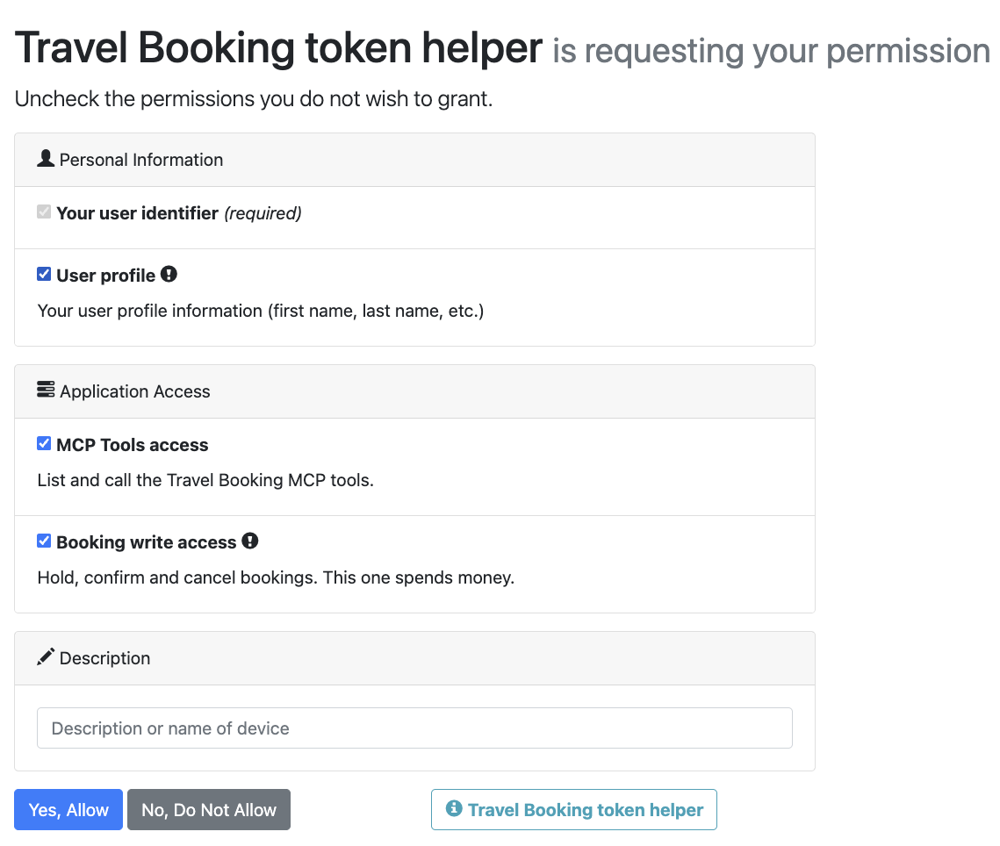

4. You land back on `/Token/Callback` carrying a one-time authorization code.
5. The page redeems that code at `/connect/token`, presenting the verifier that matches the
   hash from step 1 — and shows you the access token.

   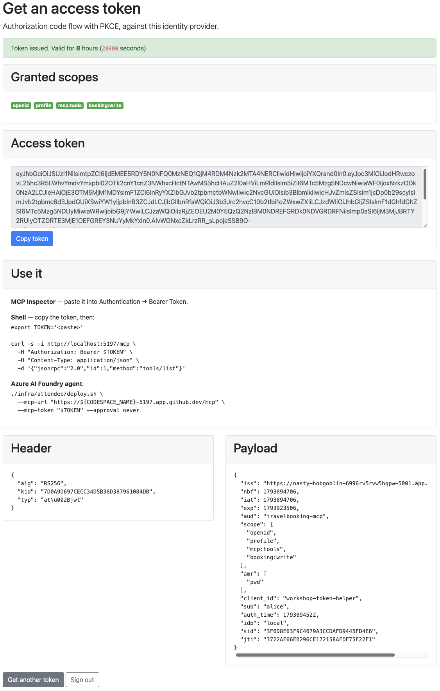

---
Read the decoded payload it prints. `iss` is your identity provider, `aud` is
`travelbooking-mcp`, `scope` lists what you were granted, and `sub` is `alice`. That is
the same token your server is about to validate, and nothing about it was faked for the
lab: real PKCE, real login, real consent, real code exchange.

**Why the callback was accepted.** The identity provider only hands an authorization code
to a `redirect_uri` it recognises, which is the correct behaviour and the reason a stolen
code is hard to use. Nobody told it where your browser is, yet it knew. Locally, the AppHost
hands it the origin Aspire publishes it on. In a Codespace, `CODESPACE_NAME` lets it predict
the `https://<codespace>-5001.app.github.dev` hostname, and GitHub's forwarding proxy stamps
`X-Forwarded-Host` and `X-Forwarded-Proto` on every request, so it also knows which door a
request came through. It believes the `https` in that header only for hosts that really
terminate TLS in front of it: Aspire's own proxy sends the same header on `localhost`,
where it is not true. On top of the predicted origins it accepts the known callback paths on
another port of **your own** Codespace or tunnel — which is what lets MCP Inspector run this
flow in a minute — and never a different tenant's, even though those live on the same
domain. The origins it accepts are logged on every start, and every rejected `redirect_uri`
is logged with the reason.

> **Only if you reach it on some other host** — a custom tunnel, say — and get
> `Invalid redirect_uri`: add that origin explicitly and restart Aspire.
>
> ```bash
> IdentityServer__ExtraOrigins=https://my-host.example.com aspire run
> ```
>
> On `localhost` or in a Codespace there is nothing to add: the origin appears in the startup
> log and nothing ever consults it.

**While you are here, look at the cookie that made it work.** Open your browser's dev tools,
find the response to the login form in the network tab, and look at the `idsrv` cookie it
sets. Two attribute combinations make a browser throw a cookie away, and both are silent:
you type the right credentials, there is no error anywhere — not in the browser, not in the
logs — and you are looking at the login page again. Nothing failed; the cookie was *never
stored*, `/connect/authorize/callback` arrived as an anonymous caller, and the only thing
IdentityServer can do with an anonymous caller is ask them to log in.

- `SameSite=None` without `Secure` — **rejected outright**, never stored. This is Duende's
  default, because it suits front-channel logout in an iframe and assumes you are on HTTPS.
  This workshop's identity provider serves plain `http`, so `Program.cs` sets
  `CookieSameSiteMode = SameSiteMode.Lax` instead. Lax is correct for this flow either way:
  the callback is a top-level GET navigation, which Lax permits.
- `Secure` while the address bar says `http://` — stored, then never sent. That happens when
  something in front claims `X-Forwarded-Proto: https` when it isn't true, which is exactly
  why the identity provider only believes that header for hosts that terminate TLS.

Both are worth seeing once, because this is the failure mode OAuth debugging is made of: the
protocol is fine, the credentials are fine, and a cookie attribute three layers down decides
whether any of it works.

> **Why does this page exist, and why is it not how you'd ship?**
> It is a dev-only OAuth client that happens to live inside the authorization server, so
> every redirect stays on one origin — which is the only reason it works unchanged on
> localhost *and* behind a per-attendee Codespaces hostname. An endpoint that prints
> access tokens into a browser is a credential leak with a nice stylesheet; it is fenced
> behind `IsDevelopment()` and the whole IdP refuses to start outside Development unless
> its deployer says so explicitly in configuration, which Lab 6 does, on purpose.

### Testing authentication

MCP Inspector can run this flow itself, the way a real client does — it reads your `401`,
follows the metadata, and opens the browser. It cannot discover *which client it is*,
though: this identity provider publishes no `registration_endpoint`, so dynamic client
registration is not on offer ("Incompatible auth server: does not support dynamic client
registration") and Inspector has to be told.

1. Start MCP Inspector if it is no longer running; a Codespace restart since Lab 1 will
   have stopped it. In a terminal of its own:

   ```bash
   npx @modelcontextprotocol/inspector
   ```

   Open the URL it prints, not a tab left over from an earlier run.
2. In Inspector's **Authentication → OAuth** settings, set **Client ID** to
   `mcp-inspector` and leave the rest as it is.
3. Set the server URL to `http://localhost:5197/mcp` — *not* the Codespace hostname.
   Inspector's backend runs inside the Codespace, and the server's metadata names
   `http://localhost:5197` as the resource, which has to match the URL you connect to.
   Port 5001 has to be public (the Codespace does that on start) because Inspector
   redeems its code from the browser rather than server-side.
4. Press **Connect**. Inspector opens the identity provider in a new tab; sign in as
   `alice` / `alice123`.
5. The consent screen that follows is the one you saw from the token page, now asking on
   behalf of Inspector, and with a third scope: Inspector asks for a refresh token by
   default, which is the `offline_access` scope. Allow all three.

   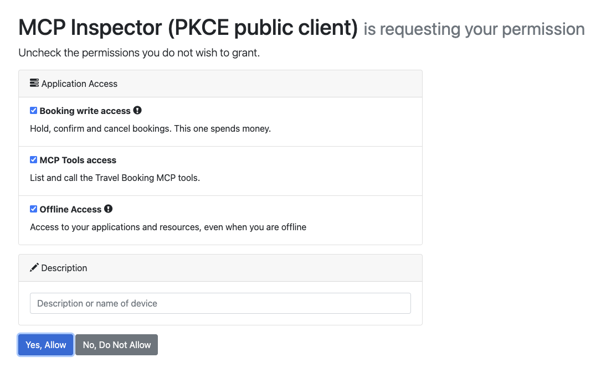

6. Back in Inspector the status turns to **Connected** and the **Tools** tab lists the
   six tools, with no token pasted anywhere.

   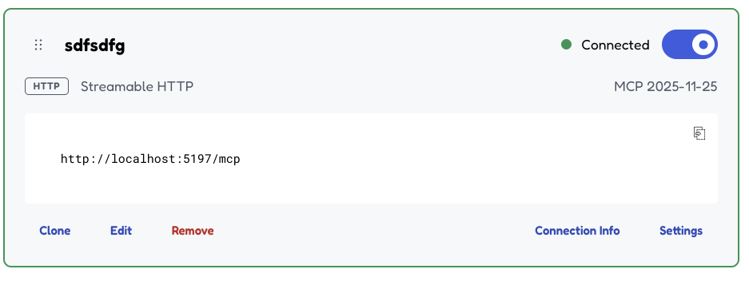

7. Now look at what the identity provider made of the request. In the Aspire dashboard
   open **Console logs**, pick the `identity-server` resource, and find the
   `GET …/connect/authorize` request. Three lines tell the story:

   - **The request itself.** Its query string carries `client_id=mcp-inspector` (what you
     configured), `scope=booking%3Awrite+mcp%3Atools+offline_access` (the scopes Inspector
     took from your server's metadata, plus its refresh token), and
     `resource=http%3A%2F%2Flocalhost%3A5197` — the RFC 8707 **resource indicator**,
     copied from the `resource` in that same metadata.
   - **`Resource indicator http://localhost:5197 names the MCP server by URL; treating it
     as the travelbooking-mcp API resource`**, a few lines down. A strict authorization
     server only accepts a resource indicator for an API resource it knows by that name,
     and ours is named `travelbooking-mcp`, so the workshop IdP maps a URL that is
     plausibly this MCP server onto it (`DevelopmentResourceIndicatorValidator`,
     Development-only; its token endpoint counterpart logs `Issuing the token for resource
     indicator …`) and the token comes out with the same `aud` as before. In production
     the resource would be registered under the server's canonical URL and the server
     would validate that URL as its audience.
   - **`Showing consent: User has not yet consented`** — the screen you just answered.

That gap is itself the lesson repeated: discovery covers *where* to authenticate, and the
spec's answer for *who is asking* is dynamic client registration, which not every
authorization server enables. If Inspector misbehaves, the token page above gets you the
same token and the lab continues. One Inspector quirk worth knowing: every launch mints
a new token for its own backend, and an open tab keeps the old one, so after restarting
Inspector open the URL it prints rather than reconnecting in the old tab (the symptom is
"Remote fetch failed (401) … x-mcp-remote-auth").

**5 — Scopes actually bite.**

Now get a token *without* `booking:write` and try to book. You don't need a different
command — you need to click a different checkbox. The result page from step 4 is still
open in the identity provider's tab; press **Get another token** at the bottom of it:

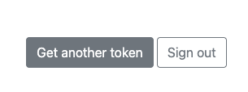

That takes you back to the start of the token page, and there are now two places where
`booking:write` can be left out. They are not the same thing:

- The checkboxes on the **token page** decide what the client *asks for*.
- The checkboxes on the **consent screen** decide what the user *grants*.

Leave both boxes on the token page ticked and press **Sign in and get a token** again:
alice is still signed in, so the login page is skipped and you land on the consent screen
straight away. (The client sets `AllowRememberConsent = false` precisely so you get asked
every time.) There, on the consent screen, **uncheck `booking:write`** and allow.

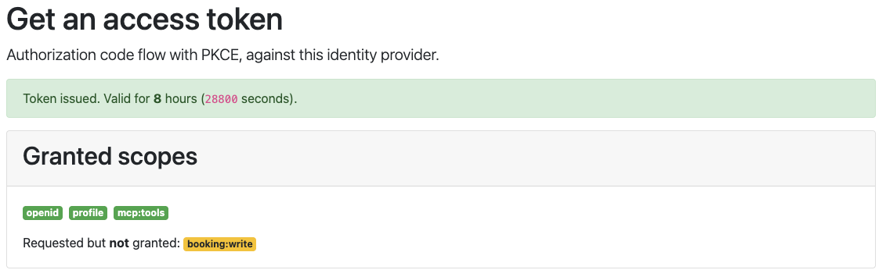

Look at the result page: under **Granted scopes** it lists `openid`, `profile` and
`mcp:tools`, and below them it says `booking:write` was *requested but not granted*. The
client asked; the user said no. That distinction is the whole reason scopes exist.

> **No "requested but not granted" line?** Then you unticked `booking:write` on the token
> page itself. That also gives you a token without the scope, and it works just as well
> for the rest of this step, but nobody said no: the client never asked, so the result
> page has nothing to report. Inspector has no such checkbox. It always asks for every
> scope your server advertises, which is why the consent screen is the only place to
> leave one out in the next part.

Now make Inspector hold a token like that. Disconnect, clear the OAuth state it kept from
the previous step (the **Clear** button under Authentication → OAuth), and press
**Connect** again. Inspector runs the whole flow once more; alice is still signed in, so
the consent screen comes straight away. **Uncheck `booking:write`** and allow.

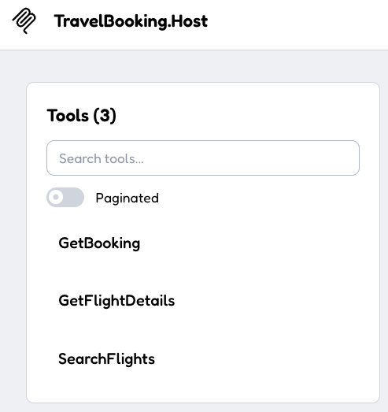

Two things happen:

- `tools/list` comes back with only **three** tools — `SearchFlights`, `GetFlightDetails`
  and `GetBooking`. The three that change state are not merely rejected, they are *not
  advertised*. That is `AddAuthorizationFilters()` doing its job, and it is the better
  half of the protection: a model cannot be tempted by a tool it cannot see.
- There is still a server-side check underneath, for the client that calls a tool it was
  never offered. A raw JSON-RPC `tools/call` for `HoldSeat` on this token comes back
  `Access forbidden: This tool requires authorization.` — the `[Authorize("CanBook")]`
  attribute, not the filter.

Same user, same server, same code path. The *token* lacks the privilege. Clear the OAuth
state once more, reconnect, grant `booking:write` this time, and all six tools reappear.

**6 — Get the agent working again, and feel bad about how.**

Foundry can't negotiate a token, so we have to hand it one. It supports a **static
credential** stored alongside the server URL — so we take a token and give it to the
agent directly.

Get one from `/Token` with **both** scopes granted, copy it, and put it in your shell:

```bash
export TOKEN='<paste the token here>'
```

Attach it to the agent:

```bash
./infra/attendee/deploy.sh \
  --mcp-url "https://${CODESPACE_NAME}-5197.app.github.dev/mcp" \
  --mcp-token "$TOKEN" --approval never
```

Back to the playground. Ask it to book a flight. It works — and now it works
*authenticated*, as `alice`, with scope-gated tools.

Now read back the opening paragraph of this lab:

> *about half of deployed MCP servers still ship with long-lived static API keys or
> nothing at all*

**You just became one of them.** A long-lived bearer token, sitting in a cloud
configuration store, presented on every call, with no refresh and no user context. Three
specific things are now true that were not true thirty minutes ago:

- **It doesn't expire usefully.** We raised the token lifetime to 8 hours in `Config.cs`
  purely so it survives the workshop. A short lifetime — the thing that makes OAuth safe —
  would mean the agent breaks mid-afternoon.
- **It's readable.** Microsoft documents that *"people who have access to the project can
  access an API key stored in a project connection."* Everyone on that Azure project can
  read alice's token.
- **The server can no longer tell who is really asking.** Every request from every user
  of that agent arrives as `alice`. The `ClaimsPrincipal` is cryptographically verified
  and completely useless for distinguishing between humans.

None of this is bad engineering on your part. It is the **cost of a non-compliant
client**, paid in security posture, and it is why "does it implement the auth spec?" is a
real procurement question and not a pedantic one.

> **What you'd actually do in production.** Put a gateway in front that performs the OAuth
> flow properly; or use a client that implements the spec — as MCP Inspector just did; or,
> if the platform supports it, configure OAuth with your identity provider so tokens are
> per-user and refreshed. Foundry does offer a custom-OAuth mode, and the gap is no longer
> the authorization server — yours answers on a public Codespaces URL and has a working
> login and consent UI. The gap is that per-user interactive consent has to happen for
> every person who talks to that agent, with a token store behind it, which is a system to
> build rather than a setting to flip.

**7 — Identity in the audit trail.**

Book a seat as alice (via the playground or the Inspector with the full-scope token), then
look in two places.

First the trace. In the Aspire dashboard open **Traces**, pick the trace of the booking,
and find the two rows for the hold: `tools/call HoldSeat`, which the MCP SDK emits, and
nested under it `tool HoldSeat`, the span your own code started in Lab 3. Click the
nested one: its attributes in the details pane now include `enduser.id: alice`. The SDK's
row above it knows the session and the method, not the user; the identity lives on your
span, and the same tag sits on `tool ConfirmBooking`.

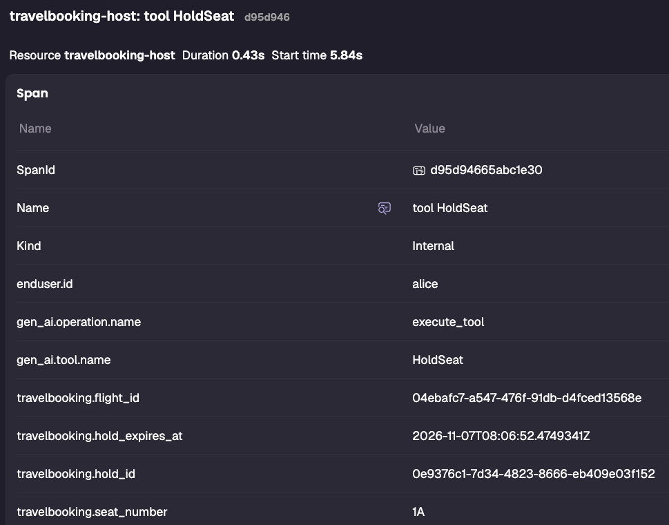

Then the audit table, in pgAdmin. Back in the dashboard's **Resources** list, click the
URL next to the `pgadmin` resource:

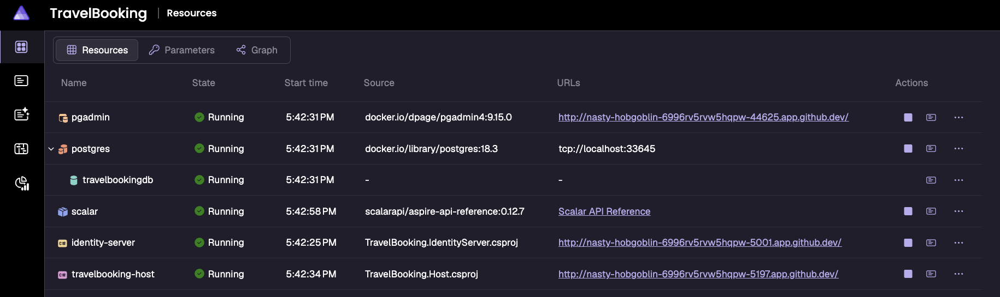

In pgAdmin's Object Explorer, expand the server **postgres**, then **Databases** →
**travelbookingdb** → **Schemas**, right-click **public** and choose **Query Tool**:

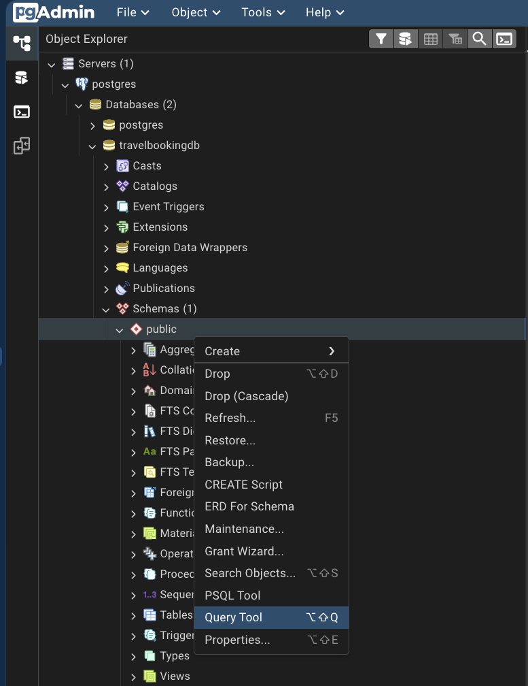

Run:

```sql
SELECT "Action",
       CASE "Outcome" WHEN 0 THEN 'success' ELSE 'failure' END AS outcome,
       "UserId", "FailureReason", "TimestampUtc"
FROM audit_entries ORDER BY "TimestampUtc" DESC LIMIT 5;
```

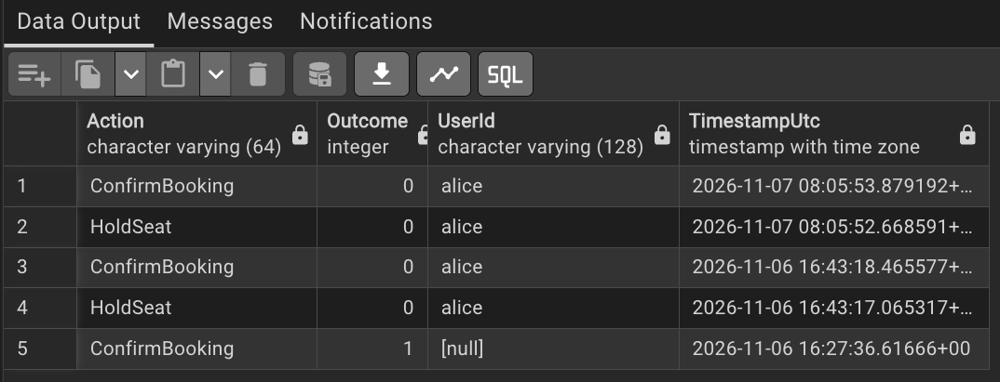

`alice` is in the `HoldSeat` and `ConfirmBooking` rows. Who did what, when, verified by
cryptography rather than by trusting a language model's imagination. If an earlier
attempt went wrong, that is in here too: a `ConfirmBooking` row with outcome `failure`,
no user and the reason *"Only the owner may confirm this hold."* is a confirmation that
arrived without an identity. The audit table does not forget.

**8 — Alice's hold is alice's.**

Foundry books as alice, so the agent is the victim here. Inspector becomes bob and tries to
steal a seat alice is holding. Get bob ready *first*: a hold lives for one minute since
Lab 4, and the sign-in takes longer than that if you leave it until after the hold.

1. In the identity provider's tab, still on the token page from step 4, press **Sign
   out**. That deletes alice's session cookie; without it the next login would sign
   you straight back in as alice.

   

2. In Inspector, disconnect, press **Clear** under Authentication → OAuth, and press
   **Connect** again. This time the login page appears: sign in as `bob` / `bob123` and
   allow all scopes. The **Tools** tab lists six tools; bob may book too.
3. Back in the Foundry playground, which still books as alice, ask:

   ```text
   Hold seat 2A on the same flight
   ```

4. Press **Traces** just below the answer, click the `HoldSeat` tool call, and find
   `holdId` in the **Output** pane on the right (scroll down a little). Copy its value.
   The clock is running: one minute from now the hold expires and a stolen id is worth
   nothing.

   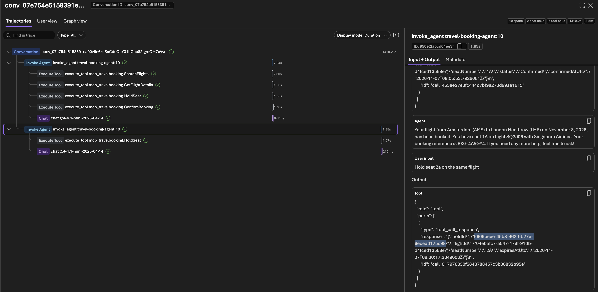

5. In Inspector, as bob, call `ConfirmBooking` with that `holdId`. The call fails:

   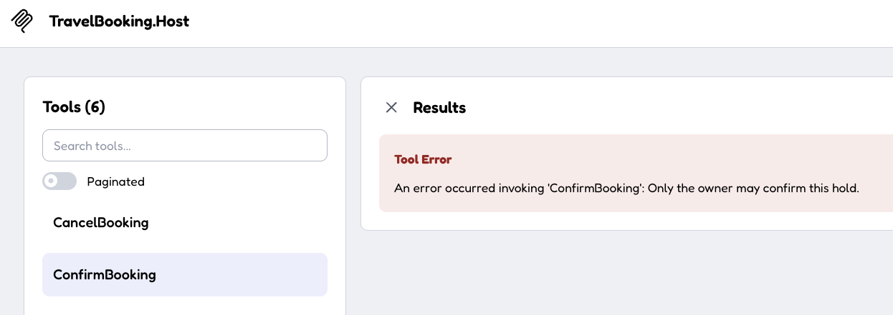

The tool never checked a thing. The domain did.

## The pitfalls your *server* avoided

Each of these is a real-world CVE pattern, and your server is immune to all of them:
**PKCE** means a stolen authorization code is useless without the verifier — you watched
that verifier never leave the server in step 4; strict **audience validation** stops token
reuse across APIs; IdentityServer's **registered redirect URIs** prevent
code-leak-by-redirect (a wildcard redirect is exactly what you'd never ship, which is why
the Codespaces callbacks are computed and registered one by one at startup rather than
matched loosely); **scope-gated tools** mean a leaked read-token can't spend money, and
can't even see the tools it couldn't use; and `ClaimsPrincipal` injection means the model
**cannot lie about who it is** — and because the ownership check lives in the domain, a caller who *could* lie still could not act on someone else's hold. None of this was exotic. It's ordinary OAuth 2.1, done
completely.

One of them lives in the *client* rather than the server, and it is worth a look because
it is the most commonly skipped line of code in OAuth: the token page sends a random
`state` and refuses the callback if what comes back doesn't match
(`Pages/Token/Index.cshtml.cs`). Without that check, an attacker can hand you a code they
obtained themselves and have your client redeem it — login CSRF, from eight missing lines.

Note the heading, though. Every one of those protections lives in the **server**, and
survives whatever the client does. The one property you could not defend —
short-lived credentials — is the one that depended on the *client* behaving, and that is
the one you lost.

That asymmetry is the lesson to take home. **Build the server as if every client is
non-compliant, because one of them will be.** Validate the audience even though a good
client would never send the wrong one. Gate by scope even when you trust the caller.
Derive identity from the token rather than the arguments. Each of those held firm today
precisely because none of them assumed anything about who was calling.

## Gate closed ✅

> ☑ Work ☑ Debuggable ☑ Observable ☑ Resilient ☑ **Secure** ☐ Deployable

Your server knows who's calling, what they're allowed to do, and writes it all down —
and you know exactly where the remaining weakness is and whose fault it is. That is a
more honest "secure" than a green checkmark, and it is fit to leave your laptop.

---

*Next up: [Lab 6 — Make It Deployable](lab-06-make-it-deployable.md).*
