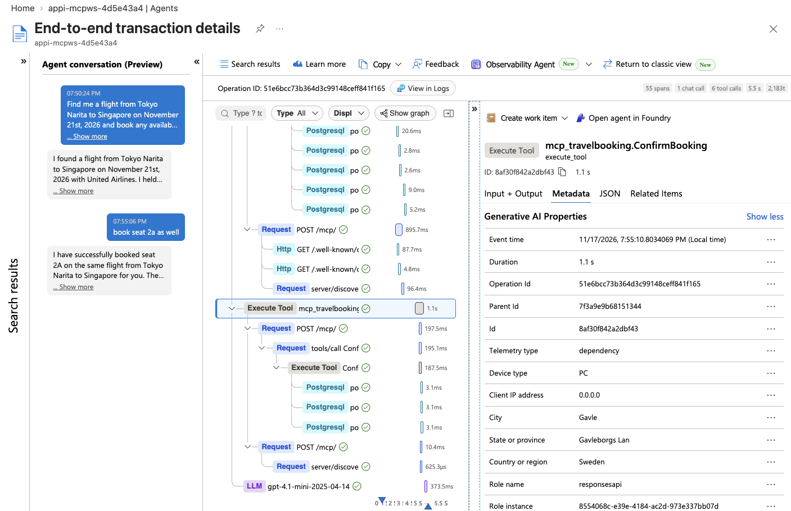

# Lab 6 — Make It Deployable (Gate 6)

In this lab the server leaves your Codespace. You will deploy the entire Aspire application
— Host, identity provider, PostgreSQL and all — to **Azure Container Apps**, point a real client at the public
endpoint, and read the same trace you've been reading all day, now spanning the internet.

> ⏱ Expected time: ~45 minutes (≈10 of which is waiting for Azure).
> Prerequisite: [Lab 5](lab-05-make-it-secure.md) completed (skipped it? see *Auth comes
> along* below). You need an **Azure subscription** you can deploy to (you arranged this
> before the workshop; a free trial works fine).
> Catching up? `./labs/prepare-lab.sh 6` puts the code exactly where this lab starts.
> Done? `./labs/prepare-lab.sh check 6` diffs your tree against the finished state of this lab.

## Why Container Apps

You met the decision in the chapter: Azure Container Apps gives you serverless containers
with HTTPS ingress, scale-to-zero, and managed infrastructure — the sweet spot between
"App Service hides too much" and "AKS makes you operate Kubernetes". Better yet, the
**Azure Developer CLI (`azd`)** understands Aspire natively: it reads your AppHost, infers
the container resources, and provisions everything. The orchestration file you've been
using all day *is* the deployment model. That's why we never wrote a docker-compose file.

## Fix the health probe first

Remember Lab 1's note that `/mcp` can't serve as a health check? Container Apps is where
that bill comes due: the first thing you will do after deploying is probe `/health` over
the public internet, and the liveness and readiness probes you would give Container Apps
in production hit the same path. Open
`src/aspire/TravelBooking.ServiceDefaults/Extensions.cs` and look at
`MapDefaultEndpoints` — the health endpoints are only mapped in **Development**. Your
container will run in Production, where `/health` doesn't exist.

Replace the method body so the endpoints are always mapped:

```csharp
    public static WebApplication MapDefaultEndpoints(this WebApplication app)
    {
        // Health endpoints are deliberately exposed in all environments for this workshop:
        // Azure Container Apps uses them as liveness/readiness probes. In a real system,
        // consider exposing them on an internal port or protecting them — see
        // https://aka.ms/dotnet/aspire/healthchecks for the trade-offs.

        // All health checks must pass for app to be considered ready to accept traffic after starting
        app.MapHealthChecks(HealthEndpointPath, new HealthCheckOptions
        {
            ResponseWriter = WriteHealthStatus
        });

        // Only health checks tagged with the "live" tag must pass for app to be considered alive
        app.MapHealthChecks(AlivenessEndpointPath, new HealthCheckOptions
        {
            Predicate = r => r.Tags.Contains("live"),
            ResponseWriter = WriteHealthStatus
        });

        return app;
    }
```

The comment the template ships with isn't paranoia: an unauthenticated health endpoint can
leak information and be hammered. For the workshop the trade-off is fine — but it's now
*your* documented decision, not an accident.

## Decide what faces the internet

Published, every Aspire resource is **internal** to the Container Apps environment unless
you say otherwise — the right default, and the reason PostgreSQL will not get a public
address. Two resources do need one. The MCP server, because the Foundry agent calls it
from Azure. And the identity provider, because your browser has to reach its login page,
and the MCP server fetches its discovery document and signing keys from it.

Open `src/aspire/TravelBooking.AppHost/AppHost.cs` and mark both with
`WithExternalHttpEndpoints()`:

```csharp
var identityServer = builder
    .AddProject<Projects.TravelBooking_IdentityServer>("identity-server")
    .WithExternalHttpEndpoints();
```

```csharp
var travelBookingHost = builder.AddProject<Projects.TravelBooking_Host>("travelbooking-host")
    .WithExternalHttpEndpoints()
    .WithReference(travelBookingDb)
    .WaitFor(travelBookingDb)
    .WaitFor(identityServer)
    // The Azure AI Foundry agent sends a W3C traceparent header. Earlier runtimes
    // sent it with the sampled flag off ("...-00"); OpenTelemetry's default
    // ParentBased sampler drops a span whose remote parent was not sampled, so
    // every trace started by the agent was silently discarded and the dashboard
    // looked empty. Today's runtime sends "...-01", but the line stays: a client
    // that sends an unsampled parent fails without a sound. Sampling everything
    // is right for a workshop; in production you would sample deliberately.
    .WithEnvironment("OTEL_TRACES_SAMPLER", "always_on");
```

In both statements the `.WithExternalHttpEndpoints()` line is the only new one; everything
else stays as it is.

Locally this changes nothing: `aspire run` already puts every endpoint on your machine. It
is a statement about the published shape only — which is the point. The orchestration file
*is* the deployment model.

While you are in the file, read the comment above `publishedScheme`. Locally the projects
listen on plain `http`; behind the Container Apps ingress they are `https`. The identity
provider stamps its own address into every token's `iss` and the MCP server validates that
value, so the scheme has to be right in both worlds. The AppHost knows which world it is
describing — `aspire run` or `azd up` — and decides once, in code. You configure nothing.
The same switch keeps Postgres' data volume local (an Azure Files share cannot hold a
Postgres cluster, so the deployed database is ephemeral and re-seeded on every start) and
moves the identity provider's keys to a path its container can write. Deployment details,
decided where the deployment is described.

## Auth comes along

Your server demands a token since Lab 5, and it keeps demanding one in the cloud: the
AppHost hands the deployed server the deployed identity provider as its
`Authentication:Authority`, so the identity provider ships too, as one more container next
to the server. Lab 5's work survives the move, and the cloud trace will carry `enduser.id`
exactly as the local one did.

Be clear about what you are deploying. The workshop identity provider is a **lab prop**:
in-memory users with passwords printed in Lab 5, a developer signing key minted when the
container starts, and a page that shows access tokens in a browser. It refuses to start
outside Development unless its deployer states, in configuration, that they know all this.
The AppHost sets that flag when it publishes, and the identity provider logs a warning on
every start so nobody forgets. **Do not do this in real life.** There you point
`Authentication:Authority` at Entra ID, or at an IdentityServer your organisation runs
properly — persisted keys, a user store, no token page. The server code would not change
by a line, only that one configuration value. That is exactly what config-driven auth buys
you, and why Lab 5 wired it that way.

> Skipped Lab 5 and did not run `prepare-lab.sh 6`? Then `UseIdentityServer` is still
> `false`, the deployed server runs open (with Lab 5's loud warning in its log), and you
> skip the token step below. Everything else in this lab is the same.

## Sign in to azd

The Codespace comes with the Azure Developer CLI installed. Check it in the Codespace
terminal:

```bash
azd version
```

```txt
azd version 1.38.0 (commit …)
```

> **`azd: command not found`, or another version?** Your Codespace was created before azd
> became part of it. Install the same version by hand:
>
> ```bash
> curl -fsSL https://aka.ms/install-azd.sh | sudo bash -s -- --version 1.38.0
> ```

Then sign in with a device code (the browser-less Codespace flow):

```bash
azd auth login --use-device-code
```

Open the printed URL on any device, enter the code, and sign in with the account that owns
your subscription.

## Initialize and deploy

From the **repository root**:

```bash
azd init
```

Choose **Use code in the current directory**. `azd` scans the repo and announces that it
found a .NET Aspire AppHost — confirm it. When asked for an **environment name**, pick
something short and unique, like `mcpworkshop-<yourname>` (it becomes part of Azure
resource names).

Then ship it:

```bash
azd up
```

Pick your subscription and a region close to the venue. Now `azd` provisions a resource
group, a Container Apps environment, a container registry, log analytics, and the
**Aspire dashboard** alongside your app — then builds your containers and deploys
`travelbooking-host`, `identity-server` and `postgres`. This takes 5–10 minutes; grab the
coffee you've earned, but keep an eye on the output.

When it finishes you'll see your endpoints:

```txt
SUCCESS: Your up workflow to provision and deploy to Azure completed in 8 minutes 41 seconds.
```

List them anytime with:

```bash
azd show
```

Note the public URLs of `travelbooking-host` and `identity-server` — something like
`https://travelbooking-host.<random>.<region>.azurecontainerapps.io`, and the same host
with `identity-server` in front. `azd` prints an endpoint for `postgres` too, but look at
its name: `postgres.internal.<random>...`. That hostname only resolves *inside* the
Container Apps environment, which is how the Host reaches the database — from the internet
it does not exist. Postgres stayed internal, exactly as the AppHost said.

## Validate the deployment

Probe the health endpoint you fixed — over the public internet this time:

```bash
curl -s https://travelbooking-host.<random>.<region>.azurecontainerapps.io/health
```

```txt
Healthy
```

The Host ran its migrations and seeding against the deployed PostgreSQL on startup, just
like it did locally — same image, same startup path, different sky.

Next, a token the cloud will accept. The one in your Foundry connection was issued by the
identity provider in your Codespace; the deployed server trusts the deployed identity
provider instead — different issuer, different signing key, rejected. Open the deployed
token page:

```txt
https://identity-server.<random>.<region>.azurecontainerapps.io/Token
```

Press **Sign in and get a token**, sign in as `alice` / `alice123`, and copy the access
token. The page's own "use it" snippet already names your Container Apps URL: the AppHost
told it where the server went.

Now the moment the whole day built toward. Point your agent at the cloud — one command,
and note what you are *not* doing: not creating a second agent, not editing a config file,
not touching the playground:

```bash
TOKEN='<paste>'
./infra/attendee/deploy.sh \
  --mcp-url https://travelbooking-host.<random>.<region>.azurecontainerapps.io/mcp \
  --mcp-token "$TOKEN"
```

Everything else is skipped as already-correct. The only things that move are where the
agent's tools live and the credential it presents there.

> This is why the MCP URL lives in a **project connection** rather than only inside the
> agent. Azure AI Foundry agent versions are immutable and the tool definition cannot be
> patched, so an agent that knew its own server URL and nothing else would be stuck with
> it. The connection is a config record the agent points at by name, and Foundry documents
> that the connection's endpoint is the one actually used. Moving your server from a
> Codespace to Azure is a one-field update to that record. Keep that trick — the general
> shape (indirect through config, don't bake endpoints into immutable artifacts) long
> outlives this particular API.

> ⚠️ **Use the playground link this run prints.** The script also updates the URL inside
> the agent definition, which publishes a new version and deletes the old one — so the
> link you have been using since Lab 2 now points at a version that no longer exists.
>
> It would be tidier not to touch the definition at all, since the connection is what
> routes the call. We do it anyway for one reason: Foundry quotes the definition's
> `server_url` in its error messages, even when the call went elsewhere. Leave it stale
> and your next failure reads *"cannot connect to `<your old Codespace URL>`"* — and you
> debug a machine that stopped existing twenty minutes ago. Error messages that name the
> wrong thing cost more than a version bump.

Open that link — same agent, same instructions, same tools — and ask (a precise date, as
always: without a year the model guesses one and finds nothing, and a vague "soon" makes it
ask you to pick):

```
Find me a flight from Tokyo Narita to Singapore on November 21st, 2026
and book any available seat. Confirm the booking right away.
```

A real AI agent just called **your MCP server, running in Azure Container Apps**, and
booked a flight. Nothing is running on your machine any more.

Prove that last part: your Codespace port can go private again.

```bash
gh codespace ports visibility 5197:private -c "$CODESPACE_NAME"
```

Ask the agent for another booking. It still works. The thing you spent all day building
no longer depends on your laptop being awake.

## Read the cloud trace

Your OpenTelemetry pipeline needed zero changes: the deployed Aspire dashboard collects
OTLP in the cloud exactly as it did locally. The dashboard URL was printed at the end of
`azd up`; if it scrolled away, open the Azure portal, navigate to your **Container Apps
environment**, and click **Aspire Dashboard**. Open it and go to **Traces**. There it is —
`POST /mcp`, your `tool HoldSeat` span, the tags from Lab 3, the database spans underneath
— the *same trace shape* you've read all day, now recording requests that crossed the
public internet — and `enduser.id: alice`, because the token came along.

This is the payoff of instrumenting early: observability survived the move to the cloud
because it was never coupled to your laptop in the first place.

> The dashboard is not the only exporter running. `ServiceDefaults` also enables
> **Azure Monitor** whenever it finds a connection string — `AddOpenTelemetryExporters`
> reads `APPLICATIONINSIGHTS_CONNECTION_STRING` first, then falls back to
> `AzureMonitor:ConnectionString` from `appsettings.json`. That is why your spans have
> been reaching Application Insights since Lab 1 as well as the dashboard — and that
> precedence is what the stretch goal below puts to work.

### Stretch goal — ship that connection string properly

In Lab 3 both halves of a booking already met in Application Insights, and deploying did
not break that: the connection string `deploy.sh` wrote into `appsettings.json` was baked
into your container image, so the deployed server still reports to the same resource
Foundry does. Open **Transaction search** there and you will find bookings that crossed
the public internet, agent span included.

Which is also the problem. You just shipped an ingestion key *inside an image*, from a
file tracked by git — the habit Lab 5 spent its time talking you out of. Fix it the way
you would in production:

1. Clear the value out of `appsettings.json` (future runs: `deploy.sh --no-appsettings`)
   and redeploy, so the image carries no credential.
2. Inject it as configuration instead. `ServiceDefaults` reads
   `APPLICATIONINSIGHTS_CONNECTION_STRING` ahead of `appsettings.json` — the conventional
   name for this setting across Azure tooling. Container Apps does not set it for you,
   so inject it yourself:
   ```bash
   az containerapp update -n travelbooking-host -g <rg> \
     --set-env-vars APPLICATIONINSIGHTS_CONNECTION_STRING="<connection string>"
   ```
3. Re-run a booking and confirm the trace still arrives — same resource, no secret in the
   repo.



Application Insights maps the W3C trace id onto its own `operation_Id`, so the two halves
join on their own. You get one view running from *the user's sentence in the playground*,
through the model's decision to call a tool, across the internet, into your container, and
down to the SQL that reserved the seat.

That is the whole story of a single agent request, end to end — and it is the thing you
could not see this morning, at any price.

## Clean up

`azd` keeps one replica of each container running, and the registry, Postgres storage and
Log Analytics bill by existence. When the workshop is over:

```bash
azd down
```

Confirm, and everything the deployment created is deleted.

Your Azure AI Foundry side has its own teardown — the Foundry resource, project, model
deployment, agent and the Application Insights holding your traces live in a separate
resource group:

```bash
./infra/attendee/deploy.sh --delete
```

(Keep both running for now if you still want to play — just don't forget before you
leave. The model deployment bills per token rather than per hour, so an idle agent costs
nothing, but the Container Apps registry and Log Analytics bill by existence.)

## If things go wrong

- **`azd up` fails on provisioning** — check you picked a subscription you own and a
  major region (e.g. `westeurope`, `eastus2`). Free trials have regional quota limits;
  trying a different region is the most common fix.
- **A page is unreachable, or a container keeps restarting** — `azd` reports "Done" when
  the deployment is accepted, not when the containers are healthy. The container's own
  stdout says why, straight from Azure:
  ```bash
  az containerapp logs show -n travelbooking-host -g rg-<your environment name> --type console --tail 50
  ```
  Swap in `identity-server` or `postgres`. A Host that dies with an Npgsql timeout is
  waiting for Postgres, which was still initialising; Container Apps restarts it until the
  database answers. Two `FATAL: database "travelbookingdb" does not exist` lines in the
  Postgres log are not a failure: that is the Host asking whether the database exists,
  right before it creates it. The Host's own log ends in `Application started`.
- **A second `azd up` succeeds, but the server still runs the old code** — the new
  revision never came up, so Container Apps kept the old one serving. If the Host's log
  (the command above) says `password authentication failed for user "postgres"`, the new
  Host was handed a different database password than the one the running Postgres
  container started with: a changed password alone does not restart Postgres. Restart
  Postgres so it starts fresh with the current password, then the Host:
  ```bash
  RG=rg-<your environment name>
  for app in postgres travelbooking-host; do
    az containerapp revision restart -n $app -g $RG \
      --revision $(az containerapp show -n $app -g $RG --query properties.latestRevisionName -o tsv)
  done
  ```
  The deployed database is ephemeral, so nothing is lost: the Host migrates and seeds it
  again on start.
- **The agent can't see its tools after the switch** — same diagnosis skills as Lab 1.
  Check the URL ends in `/mcp`, and curl the public `/health` endpoint. Then remember
  Lab 5: a 401 is the token. One from your Codespace's identity provider is rejected by
  the deployed server (different issuer), and so is one from the deployed identity
  provider after its container restarted (the developer signing key is minted at start).
  Get a fresh token from the deployed `/Token` page and re-run `deploy.sh` with it.
  Running open, without Lab 5? Clear the credential instead:
  `./infra/attendee/deploy.sh --mcp-url <aca-url> --mcp-token ""`

## One for the road

Before you close the playground, ask the agent one more thing:

```
When I book a flight, how can I compute pi with 10,000,000 digits
behind the decimal separator?
```

It answers. Happily, at length, with algorithm recommendations. Its instructions say *"You
are a travel booking assistant for an airline"* — and it is still an LLM that will talk
about anything you bring up.

Notice what did **not** happen: your server was never called. Everything you secured
today — scopes, ownership, the audit trail — sits behind the tools, and the tools are
consulted only when the model decides to consult them. The agent's own behaviour is a
different perimeter: what it will discuss, what it believes when a tool result contains
text that looks like an instruction, what it does with a user who says "ignore your
previous instructions". None of that lives in your MCP server, and none of it was today's
subject.

So here is the question to take home: you now know how to make the *server* trustworthy.
Who makes the *agent* trustworthy — and what would that even look like?

## Gate closed ✅ — all gates closed

> ☑ Work ☑ Debuggable ☑ Observable ☑ Resilient ☑ Secure ☑ **Deployable**

This morning you had an empty `Tools/` folder. You now have an MCP server that works with
real clients, surfaces its failures, traces every request, survives bad networks and double
bookings, authenticates its callers — and runs in Azure, where an agent on the other side
of the world can call it.

**You've crossed the chasm.**

---

*Back to the [lab overview](README.md) — and don't miss the production-readiness checklist
in the wrap-up chapter.*
