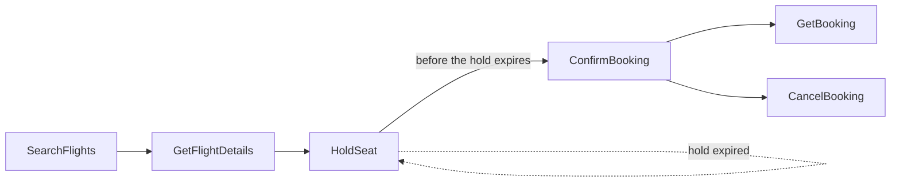

# src — Travel Booking MCP server

The demo application that threads through the entire workshop: a **Travel Booking MCP
server** built with ASP.NET Core on **.NET 11**, using `ModelContextProtocol.AspNetCore`
(streamable HTTP transport, `MapMcp("/mcp")`). PostgreSQL via EF Core, orchestrated
locally by .NET Aspire.

It starts in Chapter 02 as the smallest thing that works and is hardened gate by gate —
debuggable, observable, resilient, secure — until it deploys to Azure in Chapter 07.
The *same* codebase moves through every gate.

**Tools (Lab 1 onwards):** `SearchFlights`, `GetFlightDetails`, `HoldSeat`,
`ConfirmBooking`, `GetBooking`, `CancelBooking`. Backed by a Postgres database
(Aspire-orchestrated container) seeded with 32 global airports and about 530 flights over
the next 60 days: the six routes the labs ask for by name on a fixed schedule, plus 200
random ones.
Seat **holds expire** — the stateful mechanic that powers the tracing, resilience,
and idempotency lessons.

**Three primitives.** The tools *perform operations*. Next to them the server exposes one
example of each of the other MCP primitives, so all three can be shown on the same server:
the resource `travel://policies/baggage` (`baggage-policy`, Markdown) *supplies context* —
a short, fictional baggage policy that applies to every flight in this demo and that an
assistant should read before a traveller commits; and the prompt `book-flight`
(arguments `from`, `to`, `date`) *supplies a reusable workflow* that walks an assistant
through the six tools in order and embeds the policy, so the model has it even when the
host does not let it read resources. Fetching the prompt returns
messages only; nothing is held or booked. The consuming host must support resources and
prompts to demonstrate them: the Foundry agent used in the labs consumes tools only, while
MCP Inspector (Resources and Prompts tabs), VS Code Copilot Chat (`/mcp.<server>.book-flight`,
"Add Context → MCP Resources") and Claude Desktop do.

## The booking flow

The six tools are meant to be called in this order. A hold is temporary: confirm it before
`expiresAtUtc`, or the seat becomes available again and the flow restarts at `HoldSeat`.



`SearchFlights`, `GetFlightDetails` and `GetBooking` only read. `HoldSeat`,
`ConfirmBooking` and `CancelBooking` change state, and from Lab 5 onward they require the
`booking:write` scope.

## Layout

```
TravelBooking.Domain          ← rich entities (rules live here) + service interfaces, zero dependencies
TravelBooking.Application     ← handlers (plain services, no MediatR)
TravelBooking.Infrastructure  ← EF Core DbContext, service implementations, seeder
TravelBooking.API             ← REST endpoints (flights + bookings)
TravelBooking.MCP             ← MCP tools (Lab 1 fills this in), plus one resource and one prompt
TravelBooking.Host            ← composition root
TravelBooking.IdentityServer  ← workshop identity provider (Duende IdentityServer), used from Lab 5
aspire/
  TravelBooking.AppHost           ← Aspire orchestrator (Postgres + IdentityServer + Host)
  TravelBooking.ServiceDefaults   ← shared OTEL / health / resilience
tests/
  TravelBooking.Tests           ← xunit.v3 + AwesomeAssertions + Moq, layout mirrors src/
```

A request enters through `TravelBooking.MCP` (or `TravelBooking.API`), goes through an
Application handler and an Infrastructure service, and ends in a Domain entity that holds
the rule. [../ARCHITECTURE.md](../ARCHITECTURE.md) follows one tool call through all of
those layers, and has the component diagram, the hold and booking lifecycle, and the ADR set.

## Running

From the repository root:

```bash
aspire run
```

Without the Aspire CLI, `dotnet run --project src/aspire/TravelBooking.AppHost` does the same.
The dev container at the repo root provisions everything Codespaces needs.
